# Práctica 11 — Pruebas White Box · CHAAC XANAB

Auditoría técnica de la solución CHAAC XANAB (app móvil Flutter + API NestJS en Vercel + PostgreSQL en Supabase + SQLite local). Todos los valores de este informe salen de ejecuciones reales; los archivos de evidencia se citan entre corchetes y viven en `practica11/resultados/` (app) o `backend-chaac-xanab/practica11/` (API).

## 0. Identificación del entorno

| Elemento | Valor |
|---|---|
| Fecha de ejecución | 2026-11-11 (18:10–19:20, UTC-6) |
| Equipo cliente | Lenovo 20L7002CUS · Intel Core i7-8650U · 16 GB RAM |
| Sistema operativo | Windows 11 Pro 10.0.26200 |
| Red del cliente | Wi-Fi Intel Dual Band AC 8265 (enlace 300 Mbps) |
| App móvil | `chaac_xanab_app` versión **1.0.0+1** · Flutter 3.44.0 / Dart 3.12.0 · huella SHA-256 de `lib/`: `891028365E2473C8`. Código evaluado = primer commit del repositorio de la app, **`2272970`** (rama `main`; antes no estaba en Git, ver OBS-06) |
| API | `backend-chaac-xanab` commit evaluado **`bbf3f21`** (“Release 1.0.0”); pruebas de la práctica en el commit **`c700802`**, rama `practica11-whitebox` · NestJS 10.4 · Node 24.15 (local) |
| Sitio web | `chaac-xanab-dg` · Angular 21 + Vitest 4 (jsdom) · commit evaluado **`6a03504`**; pruebas en **`a2ae93c`** (rama `practica11-whitebox`) · publicado en `https://chaac-xanab-dg.vercel.app` (SPA estática; `/api/*` se reenvía al backend con un *rewrite* de Vercel) |
| Servidor | Vercel serverless, región **iad1** (Washington D.C.); con 10 usuarios concurrentes también **cle1** · `https://backend-chaac-xanab.vercel.app/api` (IPs 216.198.79.131 / 64.29.17.131) |
| BD servidor | PostgreSQL administrado por Supabase (acceso vía service role desde la API) |
| BD local | SQLite 3.53.4 (`chaac_xanab.db`, versión de esquema 3) |
| Herramientas | `flutter test --coverage --branch-coverage`, `flutter analyze`, Jest 29 + ts-jest, `tsc`, `npm audit`, `curl` 8.21, `ping`, script Node de carga (sustituye a k6/JMeter, no instalados) |

### Cómo reproducir

```powershell
# App (desde chaac_xanab_app)
flutter test --concurrency=1 --coverage --branch-coverage
powershell -File practica11/scripts/cobertura.ps1
powershell -ExecutionPolicy Bypass -File practica11/scripts/medir_red.ps1
node practica11/scripts/carga.mjs
# API (desde backend-chaac-xanab)
npx jest --coverage
# Sitio web (desde chaac-xanab-dg)
npm install --no-save @vitest/coverage-v8@4.0.18
npx ng test --watch=false --include="src/app/practica11/**/*.spec.ts" --coverage
powershell -ExecutionPolicy Bypass -File ../chaac_xanab_app/practica11/scripts/medir_web.ps1
```

---

## 1. Fase 1 — Inspección y análisis estático

### 1.1 Módulos principales

| Componente | Módulo | Responsabilidad |
|---|---|---|
| App | `lib/services/api_client.dart` | **Único punto de red**: agrega JWT, timeout de 20 s, traduce errores HTTP a `ApiException` |
| App | `lib/services/auth_service.dart` | Login/registro/logout, JWT en `SharedPreferences` |
| App | `lib/services/tienda_service.dart` | Endpoints de catálogo, dirección y compras |
| App | `lib/services/carrito_service.dart` | Carrito persistente en SQLite (cálculo de cantidades/total) |
| App | `lib/db/app_database.dart`, `lib/db/usuario_dao.dart` | Esquema/migraciones SQLite y CRUD de `usuarios` |
| App | `lib/config/validaciones.dart` | Reglas de entrada (extraídas de las pantallas para poder probarlas) |
| API | `auth/*` | Registro, login con bloqueo por intentos, JWT, `JwtAuthGuard`, `RolesGuard` |
| API | `productos/*`, `categorias/*` | Catálogo con caché en memoria (TTL 60 s) |
| API | `compras/*` | Alta de compra: valida stock, calcula total, inserta cabecera+renglones, descuenta stock |
| API | `admin/*`, `bitacora/*` | CRUD de administración y auditoría |
| Sitio web | `interceptors/auth.interceptor.ts` | Agrega el JWT a cada petición; ante 401 cierra sesión y redirige a `/login` |
| Sitio web | `Services/auth.service.ts`, `guards/*.guard.ts` | Token en `localStorage`, decodificación del JWT en el navegador, protección de rutas y de `/admin` |
| Sitio web | `Services/cart.service.ts` | Carrito en `localStorage` (cálculo de cantidades y total) |
| Sitio web | `utils/password-policy.ts` | Política de contraseña (misma regla que el backend) |
| API | `supabase/supabase.service.ts` | **Único acceso a BD** (cliente service role) |

**Funciones que se conectan con el servidor:** `ApiClient.get/post/put → _enviar()` (todas las peticiones de la app pasan por aquí) y `ApiService.obtenerProductos()` (pantalla de consulta de la Práctica 3).
**Métodos de acceso a BD:** app → `UsuarioDao.*`, `CarritoService.*` (sqflite con `?` parametrizado); API → `SupabaseService.db.from(...)` (query builder de PostgREST, sin SQL concatenado).

### 1.2 Herramientas ejecutadas

| Herramienta | Resultado | Evidencia |
|---|---|---|
| `flutter analyze` (flutter_lints 6) | **0 problemas** (incluye las pruebas nuevas) | [flutter_analyze.txt] |
| `tsc -p tsconfig.build.json --noEmit` | **0 errores** | [backend/practica11/tsc_build.txt] |
| `flutter pub outdated` | 3 directas con versión nueva: `sqflite` 2.4.4+1→2.4.6, `sqflite_common_ffi` 2.4.3→2.4.7, `cupertino_icons` 1.0.9→2.0.0 | [flutter_pub_outdated.txt] |
| `npm outdated` | NestJS 10.4 (última 12.4), `multer` 1.4.5-lts (última 2.5), `nodemailer` 6.10 (última 10.5), `@supabase/supabase-js` 2.100→2.119 | [backend/practica11/npm_outdated.txt] |
| `npm audit --omit=dev` | **15 vulnerabilidades: 1 crítica, 8 altas, 5 moderadas, 1 baja** (crítica: `proxy-addr`; altas: `body-parser`, `path-to-regexp`, `multer`, `nodemailer`, `ws`, `lodash`, `@nestjs/config`, `@nestjs/platform-express`) | [backend/practica11/npm_audit.txt] → DEF-11 |
| Búsqueda de secretos (regex de JWT, `sk_`, `AKIA`, `password=`, `api_key=`) | Sin credenciales reales en código; sólo datos ficticios en `*.spec.ts`. `.env` está en `.gitignore` y nunca se versionó (`git log -- .env` vacío) | — |
| `ng build` (sitio, compilación de producción con verificación de tipos) | **0 errores**; 2 avisos de presupuesto CSS (`carrito.component.css` 6.12 kB y `admin-dashboard.component.css` superan 6 kB); paquete inicial 440.9 kB (120.0 kB transferidos) | [web/ng_build.txt] |
| `npm audit --omit=dev` (sitio) | **13 vulnerabilidades: 2 críticas, 10 altas, 1 moderada** | [web/npm_audit_web.txt] → DEF-11 |
| Suite Vitest existente del sitio | 1 de 2 pruebas falla: la spec de plantilla prueba la clase `App` (`app.ts`), que **no se usa** (`main.ts` arranca `AppComponent`) | [web/ng_test.log] → OBS-10 |
| Suite Jest existente (antes de la práctica) | **13 pruebas fallando en 5 suites** (no se ejecutaba) | [backend/practica11/jest.log] → DEF-07 |

### 1.3 Puntos de revisión obligatorios

| Punto | Hallazgo | Ubicación |
|---|---|---|
| Métodos sin manejo de excepciones | `TiendaScreen._cargar()` sólo atrapa `ApiException`; un `TypeError` por JSON inesperado escapa (DEF-10). `CarritoService.agregar()` no controla `ArgumentError` de `clamp(1, 0)` (DEF-02) ni `DatabaseException` UNIQUE en concurrencia (DEF-03) | `tienda_screen.dart:49-59`, `carrito_service.dart:46-66` |
| Credenciales o claves expuestas | Ninguna. JWT del usuario guardado en `SharedPreferences` **sin cifrar** (OBS-01) y, en el sitio, en `localStorage` (accesible a cualquier script; sin CSP que lo limite, DEF-09) | `auth_service.dart:42`, `auth.service.ts:28` |
| Validaciones duplicadas o inexistentes | Antes: reglas repetidas en `login/registro/checkout` → se centralizaron en `Validaciones`. Login exige sólo `@` y el registro un correo completo (OBS-02). SQLite sin `CHECK` en `edad` (DEF-04). `UsuarioDao.actualizar()` acepta `id == null` y manda `whereArgs: [null]` (sqflite lo advierte en ejecución, OBS-03) | `validaciones.dart`, `usuario_dao.dart:20-23` |
| Código inaccesible o redundante | Sitio: `app.ts`, `app.html`, `app.css` y `app.spec.ts` son restos de la plantilla que nunca se cargan (OBS-10). Constructor privado `Validaciones._()` (intencional). `main.ts` (local) y `api/index.ts` (Vercel) duplican la configuración y **ya divergieron**: sólo `main.ts` aplica `helmet()` (DEF-09) | `api/index.ts:16-29` |
| Consultas con datos sin validar | App: todo con `?` parametrizado (probado contra `"1 OR 1=1; DROP TABLE..."`). API: PostgREST parametriza; `buscarPorTermino` construye un filtro `.or()` con texto del usuario pero lo sanitiza (quita `, ( ) % _ \` y limita a 100 caracteres) — verificado con prueba | `productos.service.ts:52-80` |
| Red bloqueando el hilo principal | No hay E/S síncrona en `lib/` (sin `*Sync()`/`sleep`). `jsonDecode` corre en el isolate de UI: 0.30 ms para el catálogo actual, 21.2 ms con 100× los datos (1.27 frames) | [rendimiento_app.json] |
| Recursos no liberados | Controladores de texto se liberan en `dispose()`. `ApiClient` usa un `http.Client` singleton (correcto, reutiliza conexiones). `setState` tras `await` sin `mounted` en `tienda_screen.dart:51,56` | `tienda_screen.dart` |

---

## 2. Fase 2 — White Box de la aplicación móvil

Se eligieron tres métodos críticos. La complejidad ciclomática se calcula como **V(G) = decisiones + 1**, contando cada condición atómica de `&&`, `||`, `?:`, `??`, `?.` y cada `catch` (criterio de condiciones múltiples).

### 2.1 Método de validación — `Validaciones` (`lib/config/validaciones.dart`)

```dart
static bool edadValida(String? valor) {
  final n = int.tryParse(valor?.trim() ?? '');   // D1: valor == null (?. / ??)
  return n != null && n >= 0 && n <= 120;        // C1 && C2 && C3
}
static bool codigoPostalValido(String? valor) {
  final t = valor?.trim() ?? '';                 // D1
  return t.length == 5 && _soloDigitos.hasMatch(t); // C1 && C2
}
static Map<String, bool> reglasPassword(String p) => {   // 5 condiciones independientes
  '8 caracteres o más': p.length >= 8, 'Una mayúscula': ..., 'Una minúscula': ...,
  'Un número': ..., 'Un símbolo': ... };
```

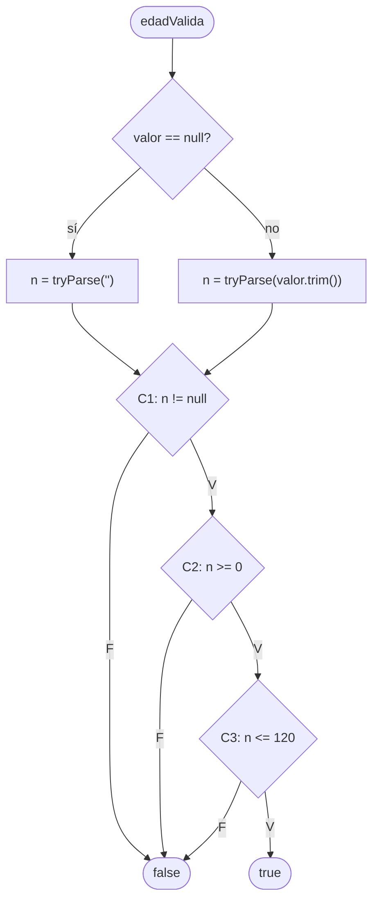

| Método | V(G) | Caminos independientes | Casos (valores límite en negritas) |
|---|---|---|---|
| `edadValida` | 5 | null · C1=F · C2=F · C3=F · todo V | `null`, `"abc"`, `"20.5"`, **`-1`, `0`, `1`, `119`, `120`, `121`**, `" 30 "` |
| `codigoPostalValido` | 4 | null · C1=F · C1=V/C2=F · todo V | **`"9700"`, `"97000"`, `"970001"`**, `"9700a"`, `"97-00"`, `null`, `" 97000 "` |
| `reglasPassword`/`passwordFuerte` | 2 (+5 condiciones) | todas V · cada condición F **aislada** | `Chaac#2026`, **`Ch#2026` (7 car.)**, **`Ab#45678` (8 car.)**, sin mayúscula, sin minúscula, sin número, sin símbolo, `""`, espacio como símbolo |
| `loginEmail` | 3 | C1=F · C1=V/C2=F · V | `null`, `"ana"`, `"a@"` |

Pruebas: [`test/validaciones_test.dart`](../test/validaciones_test.dart) — 46 casos.

### 2.2 Método de procesamiento/cálculo — `CarritoService.agregar()` (`lib/services/carrito_service.dart:46-66`)

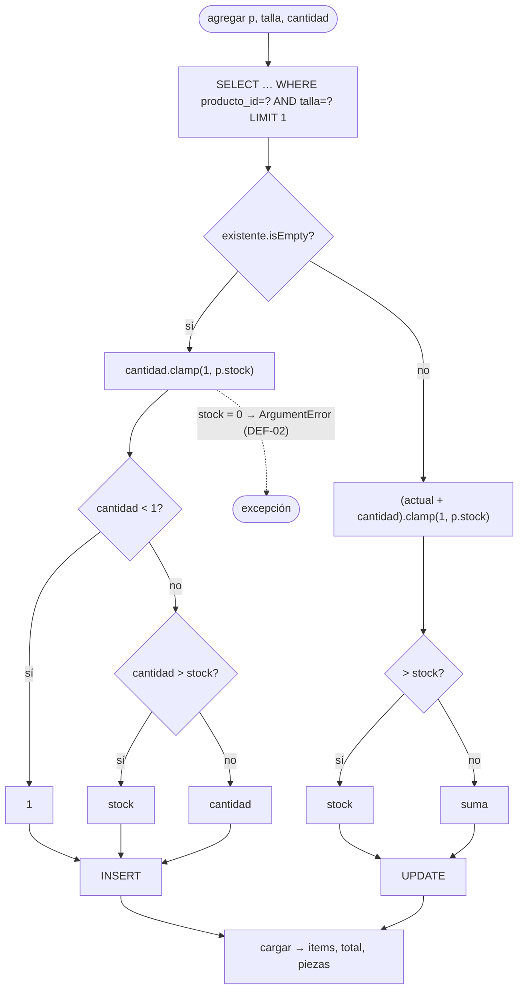

V(G) = 4 (D1 + D2 + D3 + D4 implícitas en `clamp`) → 5 caminos con la excepción.

| Camino | Caso | Esperado | Resultado |
|---|---|---|---|
| D1=V, normal | 2 piezas, stock 3 | INSERT 2, total 3000 | ✔ |
| D1=V, **límite inferior** | cantidad 0 | se ajusta a 1 | ✔ |
| D1=V, **límite superior** | cantidad 3 y 4 con stock 3 | 3 y 3 | ✔ |
| D1=F, acumula | 2 + 3 con stock 10 | UPDATE 5 | ✔ |
| D1=F, recorte | 2 + 2 con stock 3 | 3 | ✔ |
| Excepción | **stock 0** | debería rechazar de forma controlada | ✘ `ArgumentError` (DEF-02) |
| Concurrencia | dos `agregar` simultáneos | 1 fila con 2 piezas | ✘ `UNIQUE constraint failed`, queda 1 pieza (DEF-03) |

Pruebas: [`test/db_test.dart`](../test/db_test.dart), grupo `CarritoService`.

### 2.3 Método de comunicación — `ApiClient._enviar()` + `_mensajeDe()` (`lib/services/api_client.dart:55-86`)

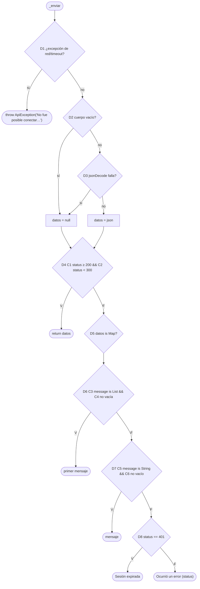

V(G): `_enviar` = 6, `_mensajeDe` = 7. Casos diseñados ([`test/api_client_test.dart`](../test/api_client_test.dart)):

| Camino / condición | Entrada simulada | Resultado |
|---|---|---|
| D1=V | `SocketException`, `TimeoutException` | ApiException sin `status` ✔ |
| D2=V | 204 sin cuerpo | `null` ✔ |
| D3=V | 200 con HTML | `null`, no lanza ✔ |
| C1/C2 **límites** | **199, 200, 201, 299, 300** | éxito sólo en 200–299 ✔ |
| C3=V C4=V | 400 `message: [..]` (class-validator) | primer mensaje ✔ |
| C3=V C4=F | 422 `message: []` | genérico ✔ |
| C5=V C6=V / C6=F | 404 con texto / 401 con `""` | texto / sesión expirada ✔ |
| D5=F | 502 HTML, 500 con lista | genérico, `cuerpo == null` ✔ |
| 403 ≠ 401 | 403 | `noAutorizado == false` (no cierra sesión) ✔ |
| `AuthService` | 401 en `restaurar()`, sin red, login OK, `EMAIL_NOT_VERIFIED`, `ACCOUNT_LOCKED` con y sin minutos, 409 en registro, logout sin red | ✔ |

### 2.4 Cobertura obtenida (módulos críticos de la app)

`flutter test --branch-coverage` (Dart no escribe `BRF/BRH`; `practica11/scripts/cobertura.ps1` los calcula desde `BRDA`). [cobertura_flutter.csv]

| Archivo | Instrucciones | Ramas |
|---|---|---|
| `services/api_client.dart` | 37/37 (100 %) | 27/27 (100 %) |
| `services/auth_service.dart` | 42/42 (100 %) | 21/21 (100 %) |
| `services/carrito_service.dart` | 51/51 (100 %) | 17/17 (100 %) |
| `db/usuario_dao.dart` | 13/13 (100 %) | 4/4 (100 %) |
| `config/validaciones.dart` | 33/34 (97.1 %) | 15/16 (93.8 %) |
| `screens/checkout_screen.dart` | 93/93 (100 %) | 28/31 (90.3 %) |
| **Total módulos críticos** | **269/270 (99.6 %)** | **112/116 (96.6 %)** |

**Rutas no ejecutadas (justificadas):** `Validaciones._()` es un constructor privado que impide instanciar la clase: inalcanzable por diseño. Las 3 ramas de `checkout_screen.dart` son `if (!mounted) return` después de `await` (el usuario cierra la pantalla a mitad de la petición); forzarlas sólo probaría el framework. No se escribieron pruebas artificiales para llegar a 100 %.

Resultado global: **109 pruebas, 109 aprobadas** [flutter_test.log].

---

## 3. Fase 3 — White Box del sitio web / API

### 3.1 Método

`src/practica11/http.e2e.spec.ts` levanta la API **igual que `api/index.ts`** (prefijo `/api`, mismo `ValidationPipe`) con controladores, `JwtAuthGuard`, `RolesGuard`, `JwtStrategy` y servicios **reales**; sólo `SupabaseService` se sustituye por `FakeSupabase`, que reproduce las restricciones de `migration.sql` (UUID inválido → `22P02`, `CHECK stock >= 0`, `UNIQUE email`) y permite inyectar latencia y fallas. Las peticiones viajan por TCP con `fetch`. Además, los casos sin credenciales se repitieron **contra producción** con `curl`.

Endpoints revisados: `POST /api/auth/register`, `POST /api/auth/login`, `GET /api/auth/me`, `GET /api/productos[/:id]`, `POST /api/compras`, `GET /api/compras/mis-compras`, `GET /api/compras/:id`, `GET|DELETE /api/admin/productos`.

### 3.2 Códigos HTTP

| Código | Situación probada | Local (e2e) | Producción |
|---|---|---|---|
| 200 | `GET /productos` (sólo activos), `GET /productos/:id`, `GET /auth/me`, compra propia | ✔ | ✔ catálogo y categorías |
| 201 | `POST /auth/register`, `POST /compras` (total calculado por el servidor, stock descontado, aparece en historial) | ✔ | — (requiere cuenta) |
| 204 | `DELETE /admin/productos/:id` | **No se usa**: responde 200 con `{message}` (borrado lógico). Aceptable, documentado | — |
| 400 | email inválido, contraseña débil, nombre vacío, campo extra `role` (forbidNonWhitelisted), JSON mal formado, `items: []`, `quantity: 0`, `producto_id` no UUID, `size` vacío, `badge` fuera de catálogo | ✔ | ✔ registro, JSON, badge |
| 401 | sin token, firma alterada, token expirado, JWT sin `sub`, contraseña errónea, correo inexistente (**mismo mensaje**: no revela si existe), `EMAIL_NOT_VERIFIED`, `ACCOUNT_LOCKED` al 5.º intento | ✔ | ✔ sin token / token inválido / admin |
| 403 | cliente pidiendo la compra de otro usuario; cliente en `/admin/productos` | ✔ | — |
| 404 | producto UUID inexistente, producto inactivo, compra inexistente, ruta inexistente | ✔ | ✔ |
| 409 | registro con correo existente (sin importar mayúsculas) | ✔ | — |
| 422 | Nest usa 400 para validación. Casos semánticos (stock insuficiente) devuelven **400** → OBS-04 | — | — |
| 500 | Supabase caído en `GET /productos`: 500 genérico **sin filtrar detalles** ✔. **`GET /productos/abc` → 500** (DEF-05) | ✔ | ✔ **DEF-05 confirmado en producción** |

**¿Siempre 200?** No: 11 casos distintos devolvieron el código correcto en producción [red.json › codigos].
**¿Confunde 401 y 403?** No: sin token / token inválido → 401; autenticado sin permiso → 403. En la app, `ApiException.noAutorizado` sólo es verdadero con 401, así que un 403 no cierra la sesión (probado).

### 3.3 Estructura JSON y datos sensibles

- Errores con forma uniforme `{message, error, statusCode}`; validación con `message: string[]` (la app toma el primero).
- Las 10 respuestas de `GET /productos` midieron **exactamente 10,585 bytes** con las mismas llaves.
- `POST /auth/login` devuelve **sólo** `{token}`; `/auth/me` no incluye `password_hash` (el `select` lista columnas explícitas — el doble de Supabase proyecta columnas como PostgREST para comprobarlo); el registro no devuelve contraseña ni hash, y el hash es bcrypt.
- Defecto: con Supabase inaccesible, `/compras/*` responde **400** con el mensaje interno `TypeError: fetch failed` (DEF-06).
- Cabeceras en producción: `strict-transport-security` presente (lo pone Vercel), pero **`x-powered-by: Express`** y **sin** `x-content-type-options` / `x-frame-options` / CSP (DEF-09).

### 3.4 Cobertura del backend

`npx jest --coverage`: **10 suites, 100 pruebas, 100 aprobadas** (antes de la práctica: 13 fallaban). [jest.log, coverage/]

| Archivo crítico | Instrucciones | Ramas |
|---|---|---|
| `compras/compras.service.ts` | 58/58 (100 %) | 23/27 (85.2 %) |
| `compras/compras.controller.ts` | 15/15 (100 %) | — |
| `productos/productos.service.ts` | 49/51 (96.1 %) | 18/22 (81.8 %) |
| `productos/productos.controller.ts` | 11/11 (100 %) | — |
| `auth/guards/roles.guard.ts` | 14/14 (100 %) | 2/2 (100 %) |
| `auth/strategies/jwt.strategy.ts` | 11/11 (100 %) | 1/1 (100 %) |
| **Total críticos** | **158/160 (98.8 %)** | **44/52 (84.6 %)** |

Ramas no cubiertas: los `?? null` / `?? []` defensivos sobre respuestas de Supabase con `data === null` sin error, que PostgREST no produce en esos endpoints. El total del proyecto (40.7 % instrucciones) es bajo porque módulos fuera de alcance (Elasticsearch, Channel3, correo, WebAuthn, admin de usuarios) no tienen pruebas HTTP.

---

### 3.5 Sitio web (frontend Angular)

Pruebas en `chaac-xanab-dg/src/app/practica11/` con Vitest + `TestBed`. Las peticiones HTTP se interceptan con `HttpTestingController`, así que pasan por el `authInterceptor` real. [web/ng_test.log]

**Métodos analizados**

| Tipo | Método | V(G) | Caminos / casos | Resultado |
|---|---|---|---|---|
| Validación | `passwordPolicyError()` — 5 `if … return` en cascada | 6 | Cada regla en falso por separado, contraseña válida, **límites 7 y 8 caracteres**, vacía y orden de evaluación (11 casos) | 11/11 ✔ |
| Cálculo | `CartService.addToCart()`, `updateQuantity()`, `getTotal()`, `loadCart()` | 2 c/u | Producto nuevo o existente, otra talla, **cantidad que no baja de 1**, persistencia en `localStorage`, JSON corrupto (11 casos) | 11/11 ✔, 3 confirman DEF-13 |
| Comunicación | `authInterceptor` — D1 `token`, D2 `status === 401` (C1) `&& token` (C2) | 3 | Sin token / con token; 401 con sesión → cierra sesión y redirige; 401 sin sesión (login fallido) → no redirige; **403 → conserva la sesión**; error de red (status 0) | ✔ |
| Comunicación | `AuthService` (`getCurrentUser`, `isLoggedIn`, `login`, `logout`) y guards | 3 / 3 | Token ausente, mal formado o vencido; sin `exp`; rol cliente o admin; login con y sin éxito; logout sin red; **contrato de 9 rutas** contra `AuthController` | ✔, 2 confirman DEF-14 |
| Comunicación | `ComprasService` | 1 | `POST /api/compras` con el DTO correcto; el error 400 llega al componente | ✔ |

**Cobertura de los módulos críticos del sitio** (`ng test --coverage`): **100 % de instrucciones, 100 % de ramas y 100 % de funciones** en `password-policy.ts`, `cart.service.ts`, `auth.service.ts`, `compras.service.ts`, `auth.interceptor.ts`, `auth.guard.ts` y `admin.guard.ts` [web/cobertura_web.json]. Suite completa: **42 de 43**; la única falla es la spec de plantilla sobre código muerto (OBS-10).

**El sitio en producción** (`https://chaac-xanab-dg.vercel.app`, `medir_web.ps1`) [web/web.json]

| Medición | Resultado |
|---|---|
| 10 × `GET /` (HTML de 1,528 bytes) | 10/10 = 200 · promedio **296.0 ms** (mín. 250.1, máx. 411.1, σ 43.3) · `x-vercel-cache: HIT` |
| Paquete `main-*.js` (24,664 bytes, 3 descargas) | 0.355 / 0.313 / 0.300 s → 0.556 / 0.631 / 0.658 Mbps |
| 10 × `GET /api/productos` **a través del sitio** (rewrite) | 1.ª petición **3,053 ms** (arranque en frío); las 9 restantes promedian **311.5 ms** |
| 10 × `GET /api/productos` **directo a la API** | promedio **296.4 ms** (σ 16.0) → el salto del rewrite agrega ≈ 15 ms |
| Rutas | `/`, `/login` → 200; **`/no-existe` → 200** (la SPA responde todo con `index.csr.html`, OBS-11); `/api/no-existe` → 404 y `/api/auth/me` sin token → 401 (los códigos de la API se conservan a través del rewrite) |
| Cabeceras | `strict-transport-security` presente; **sin** `content-security-policy`, `x-frame-options` ni `x-content-type-options` (DEF-09) |

**Almacenamiento del navegador (persistencia del sitio):** el carrito (`chaac_cart`) y el token (`chaac_token`) viven en `localStorage`. Se probó que el carrito sobrevive al recargar la página, que un JSON corrupto se recupera como carrito vacío y que un JSON válido que no es una lista rompe el cálculo del total (DEF-13).

## 4. Fase 4 — White Box de la base de datos

### 4.1 Operaciones (SQLite local, mismo motor y código que en el teléfono vía `sqflite_common_ffi`)

| # | Operación | Resultado | Evidencia |
|---|---|---|---|
| 1 | Inserción válida (`UsuarioDao.insertar`) | id > 0, se lee igual | `db_test` DB-01 |
| 2 | Inserción incompleta (`nombre = NULL`) | `DatabaseException` NOT NULL; **no queda fila parcial** | DB-02 |
| 2b | Carrito duplicado `(producto_id, talla)` | `UNIQUE constraint failed` | DB-02 |
| 2c | `edad = 'abc'` y `edad = -5` | **Se guardan** (sin `CHECK`); al leer, `Usuario.fromMap` lanza `TypeError` | DEF-04 |
| 3 | Consulta por id existente | 1 fila | DB-01 |
| 4 | Consulta por id inexistente | lista vacía, sin excepción | DB-03 |
| 5 | Actualización | 1 fila; id inexistente → 0 | DB-04 |
| 6 | Eliminación | 1 fila; repetir → 0 | DB-05 |
| 7 | Persistencia | se verificó leyendo desde **una segunda conexión independiente** | DB-04 |
| 8 | Concurrencia sobre el mismo registro | `agregar` ×2 simultáneo → `SqfliteFfiException(2067) UNIQUE`, queda **1 pieza de 2**; `UPDATE` ×2 → gana la última escritura (7) | DB-06, [db_metricas.json] |
| — | Transacción con fallo a la mitad | rollback completo, 0 filas | `db_test` |
| — | Inyección SQL `"1 OR 1=1; DROP TABLE usuarios; --"` | 0 filas afectadas, tabla intacta (parámetros `?`) | `db_test` |

**Servidor — integridad en la BD real (Supabase SQL Editor)** [supabase_integridad.json]. Cada sentencia inválida se ejecutó con `pg_temp.intentar()`, que atrapa el error y revierte cualquier cambio:

| Restricción | Sentencia inválida | Resultado |
|---|---|---|
| FK `productos.categoria_id` | producto con categoría inexistente | **Rechazada** `23503` (`productos_categoria_id_fkey`) |
| CHECK `stock >= 0` | `stock = -1` | **Rechazada** `23514` (`productos_stock_check`) |
| CHECK `price >= 0` | `price = -5` | **Rechazada** `23514` (`productos_price_check`) |
| NOT NULL `productos.name` | `name = NULL` | **Rechazada** `23502` |
| UNIQUE `usuarios.email` | correo duplicado | **Rechazada** `23505` (`usuarios_email_key`) |
| CHECK `compras_items.quantity > 0` | `quantity = 0` | **Rechazada** `23514` (`compras_items_quantity_check`) |
| CHECK `compras.status IN (...)` | `status = 'regalado'` | **Rechazada** `23514` (`compras_status_check`) |

7/7 rechazadas: el esquema de PostgreSQL sí protege la integridad. Los defectos DEF-03 y DEF-08 no vienen de restricciones faltantes, sino de la lógica de la API (lectura-cálculo-escritura sin transacción): el `CHECK stock >= 0` no puede detectar la sobreventa porque ambas peticiones escriben un valor válido (`0`).

**Servidor (POST /api/compras con FakeSupabase):** inserción válida (201), inválida (400 sin insertar), consulta existente/inexistente (200/404), persistencia en el historial, borrado lógico de producto, y:
- **Sin transacción** (DEF-08): si falla el `INSERT` de `compras_items` queda la cabecera `compras` huérfana; si falla el `UPDATE` de stock la compra se confirma igual (error ignorado).
- **Concurrencia** (DEF-03): dos compras simultáneas del último par (stock 1) → **ambas 201**, 2 piezas vendidas. El `CHECK (stock >= 0)` no lo evita porque ambas escriben `1 - 1 = 0` calculado sobre una lectura previa.

### 4.2 Restricciones e índices (revisión de `migration*.sql`)

| Tabla | NOT NULL / UNIQUE / CHECK | FK | Índices |
|---|---|---|---|
| `usuarios` | `email UNIQUE NOT NULL`, rol FK a `roles(nombre)` | — | `usuarios_email_key` (por UNIQUE) |
| `productos` | `price >= 0`, `stock >= 0`, `badge IN (...)` | `categoria_id → categorias` | `idx_productos_categoria` |
| `compras` | `total >= 0`, `status IN (...)` | `user_id → usuarios ON DELETE CASCADE` (DEF-07), `direccion_id` | `idx_compras_user` |
| `compras_items` | `quantity > 0` | `compra_id ON DELETE CASCADE`, `producto_id` | `idx_compras_items_compra` |
| `bitacora` | `accion IN (...)` | `usuario_id ON DELETE SET NULL` | `usuario_id`, `accion`, `created_at` (no `usuario_email`) |
| SQLite `carrito` | todas NOT NULL, `UNIQUE(producto_id, talla)` | — | `sqlite_autoindex_carrito_1` |
| SQLite `usuarios` | NOT NULL, **sin CHECK** | — | sólo PK (búsqueda por correo = SCAN) |

Consultas que traen más de lo necesario: `getDireccion` usa `select('*')`; `GET /productos` devuelve el catálogo completo sin paginar (10.6 KB hoy; ver §5 y pregunta 5). RLS: la API usa la *service role key*, que **ignora RLS**; la seguridad depende 100 % de los guards de NestJS.

### 4.3 Tiempos de consulta y planes de ejecución

**SQLite (1,000 usuarios, 200 renglones de carrito, promedio de 50 ejecuciones)** [db_metricas.json]

| Consulta | Plan (`EXPLAIN QUERY PLAN`) | Tiempo |
|---|---|---|
| `SELECT * FROM usuarios WHERE id = ?` | `SEARCH usuarios USING INTEGER PRIMARY KEY (rowid=?)` | **0.704 ms** |
| `SELECT * FROM usuarios WHERE correo = ?` | `SCAN usuarios` (sin índice) | **0.627 ms** |
| `SELECT * FROM carrito WHERE producto_id=? AND talla=? LIMIT 1` | `SEARCH carrito USING INDEX sqlite_autoindex_carrito_1` | **0.640 ms** |
| `SELECT * FROM usuarios ORDER BY id` (1,000 filas) | `SCAN usuarios` | **2.671 ms** |

Todas muy por debajo del objetivo de 200 ms; la mayor parte del tiempo es el paso de mensajes al isolate de sqflite, no la consulta.

**PostgreSQL (Supabase)** — `EXPLAIN (ANALYZE, BUFFERS)` ejecutado en el SQL Editor de Supabase [supabase_explain.json, script `sql/explain_supabase.sql`]:

| Consulta (endpoint) | Plan | Filas | Planning | **Execution** |
|---|---|---|---|---|
| Q1 Catálogo (`GET /productos`): `productos ⟕ categorias WHERE activo ORDER BY created_at` | `Seq Scan productos` (6 inactivas descartadas) + `Hash Left Join` + `Sort` quicksort 31 kB | 27 | 0.762 ms | **0.256 ms** |
| Q2 Login: `usuarios WHERE email = ?` | `Seq Scan usuarios` (37 filas, 1 página) | 0 | 0.411 ms | **0.126 ms** |
| Q3 Historial (`/compras/mis-compras`) | `Bitmap Index Scan on idx_compras_user` + `Index Scan using idx_compras_items_compra` | 0 | 1.028 ms | **0.192 ms** |
| Q4 Bitácora por correo | `Seq Scan bitacora` (215 filas, sin índice en `usuario_email`) | 0 | 0.387 ms | **0.237 ms** |

Todas las lecturas salieron de la caché de PostgreSQL (`shared hit`, sin lecturas de disco). Q2 no usa `usuarios_email_key` porque la tabla cabe en una sola página y un recorrido secuencial es más barato; con miles de usuarios el planificador cambiaría a `Index Scan`. Q3 confirma que los índices de `migration.sql` sí se usan.

**Interpretación:** ejecutar la consulta en PostgreSQL cuesta **0.13–0.26 ms**, pero la escritura por la API (`SELECT usuarios` + `INSERT bitacora`) tarda **212 ms** y la lectura cacheada **114 ms** [carga.json]. Esa diferencia de ≈ 98 ms la explican los dos viajes de red Vercel→Supabase (≈ 49 ms cada uno), no el trabajo de la base de datos.

### 4.4 Directo en BD vs. desde la app

| Aspecto | Directo (SQLite / SQL Editor) | Desde la app |
|---|---|---|
| Tiempo | 0.6–2.7 ms (SQLite, incluye el paso de mensajes al isolate); **0.13–0.26 ms** de ejecución en PostgreSQL | 106–150 ms con conexión reutilizada; 266–397 ms con conexión nueva |
| Validación | Sólo restricciones de la tabla (SQLite acepta `edad='abc'`) | DTO + ValidationPipe + validadores de Flutter |
| Seguridad | Service role ignora RLS | JWT + guards |
| Datos devueltos | Lo que pida el `SELECT` | Proyección del servicio + caché de 60 s (puede servir datos de hasta 60 s de antigüedad, distinta por instancia) |

---

## 5. Fase 5 — Conectividad y rendimiento

Condiciones: Wi-Fi doméstico, equipo de §0, servidor Vercel iad1, sin otras descargas activas, 2026-11-11 ≈18:58 UTC-6. [red.json, ping.txt, carga.json]

### 5.A Ping ICMP (20 paquetes a `backend-chaac-xanab.vercel.app`)

| Mínimo | Promedio | Máximo | Desv. estándar | Pérdida |
|---|---|---|---|---|
| 25 ms | **27.8 ms** | 31 ms | 1.67 ms | **0 %** (20/20) |

Muestras: 26, 28, 30, 29, 30, 30, 27, 27, 27, 31, 26, 25, 28, 26, 29, 27, 27, 26, 28, 29. Vercel sí responde ICMP; el ping mide el borde (edge) de Vercel, **no** la función ni Supabase.

### 5.B Latencia HTTP — desglose con conexión nueva por solicitud (`curl -w`)

| Fase | Promedio |
|---|---|
| DNS | 14.7 ms |
| Handshake TCP | 59.0 ms |
| Handshake TLS | 95.8 ms |
| Servidor + 1 RTT (hasta primer byte) | 146.8 ms |
| Descarga de 10.6 KB | < 1 ms |
| **Total** | **316.5 ms** |

Con conexión reutilizada (keep-alive, solicitudes 2–10): **118 ms** promedio (108–151 ms). Es decir, **≈ 54 % del tiempo con conexión nueva (169.5 de 316.5 ms) se va en DNS+TCP+TLS**.

### 5.C Tasa de transferencia — Tasa (Mbps) = bytes × 8 / tiempo(s) / 1,000,000

| Medición | Bytes | Tiempo (s) | Mbps (1 / 2 / 3) | Promedio |
|---|---|---|---|---|
| Descarga JSON `/api/productos` | 10,585 | 0.440 / 0.301 / 0.287 | 0.192 / 0.281 / 0.295 | **0.256 Mbps** |
| Descarga imagen de producto (CDN) | 72,177 | 0.497 / 0.192 / 0.192 | 1.161 / 3.003 / 3.015 | **2.393 Mbps** |
| Subida JSON a `/auth/register` (rechazado con 400 tras recibirlo; no crea datos) | 90,067 | 0.562 / 0.469 / 0.422 | 1.283 / 1.535 / 1.707 | **1.508 Mbps** |

Interpretación: con respuestas pequeñas la “tasa” la domina la latencia, no el ancho de banda (la transferencia del JSON dura < 1 ms de 300 ms). Con gzip (`Accept-Encoding: gzip`, que la app envía) el catálogo pesa **2,634 bytes** en lugar de 10,585 (−75 %).

### 5.D Diez solicitudes consecutivas — `GET /api/productos` (conexión nueva cada vez)

| Solicitud | Código | Tiempo (ms) | Tamaño (bytes) |
|---|---|---|---|
| 1 | 200 | 397.0 | 10,585 |
| 2 | 200 | 280.1 | 10,585 |
| 3 | 200 | 317.0 | 10,585 |
| 4 | 200 | 265.9 | 10,585 |
| 5 | 200 | 302.2 | 10,585 |
| 6 | 200 | 345.8 | 10,585 |
| 7 | 200 | 287.5 | 10,585 |
| 8 | 200 | 305.2 | 10,585 |
| 9 | 200 | 269.6 | 10,585 |
| 10 | 200 | 395.0 | 10,585 |
| **Prom. / mín. / máx.** | 10/10 = 200 | **316.5 / 265.9 / 397.0** (σ = 48.0) | 10,585 constante |

### 5.E Prueba de interrupción

No se puede apagar la red de un teléfono físico desde el entorno de pruebas, así que se simuló a nivel de transporte con la **pantalla real** `CheckoutScreen` (`test/conectividad_test.dart`): el `http.Client` lanza `SocketException('Network is unreachable')`, igual que en modo avión.

| Criterio | Resultado |
|---|---|
| ¿Detecta el error? | ✔ muestra “No fue posible conectar con la tienda. Revisa tu conexión a internet.” |
| ¿Evita mostrar éxito falso? | ✔ no aparece “¡Compra realizada!” |
| ¿Conserva los datos? | ✔ carrito intacto (1 renglón, 2 piezas); el formulario conserva la dirección |
| ¿Reintenta de forma controlada? | Parcial: no hay reintento automático; el botón se rehabilita para reintento manual (NET-06 ✔: al volver la red responde 201, muestra éxito y vacía el carrito en SQLite) |
| ¿Evita duplicados al recuperar? | ✘ si la conexión se corta **después** de que el servidor procesó la compra, el reintento crea una **segunda compra** (DEF-01) |
| Token vencido durante el checkout | ✔ 401 → cierra sesión, avisa y conserva el carrito |

### 5.F Carga controlada (`practica11/scripts/carga.mjs`, 20 solicitudes por escenario, calentamiento previo)

Lectura: `GET /api/productos`. Escritura: `POST /api/auth/login` con un correo ficticio (según el código: SELECT `usuarios` + INSERT `LOGIN_FALLIDO` en `bitacora` → 401 esperado). Al revisar la BD después, **no se guardó ninguna de las 60 filas** (DEF-12).

| Endpoint | Usuarios | Éxito | Fallo | Promedio | P50 | **P95** | Máx. | Req/s | Transferencia | Regiones |
|---|---|---|---|---|---|---|---|---|---|---|
| Lectura | 1 | 20 | 0 | 114.3 ms | 114.1 | **123.6** | 124.2 | 8.75 | 741 kbps | iad1 |
| Lectura | 5 | 20 | 0 | 245.8 ms | 120.9 | **316.0** | 1,945.5 | 8.88 | 752 kbps | iad1 |
| Lectura | 10 | 20 | 0 | 198.5 ms | 163.9 | **320.3** | 441.5 | 32.39 | 2,743 kbps | iad1, cle1 |
| Escritura | 1 | 20 | 0 | 211.8 ms | 211.7 | **229.4** | 301.1 | 4.72 | 3.3 kbps | iad1 |
| Escritura | 5 | 20 | 0 | 353.0 ms | 242.7 | **806.7** | 1,025.7 | 13.26 | 9.1 kbps | iad1 |
| Escritura | 10 | 20 | 0 | 279.5 ms | 235.4 | **411.1** | 554.8 | 25.91 | 17.8 kbps | iad1 |

- **120/120 respuestas correctas**, ningún error de red ni 5xx.
- El rendimiento escala (8.8 → 32 req/s en lectura) porque Vercel crea instancias nuevas; el costo es la **cola larga**: con 5 usuarios una solicitud tardó 1,945 ms (arranque en frío de una instancia nueva) y con 10 usuarios apareció una segunda región (`cle1`).
- Escritura ≈ 100 ms más lenta que lectura en todos los escenarios: la lectura sale de la caché en memoria; la escritura hace 2 viajes a Supabase.
- Cliente: 47–94 ms de CPU y ≈ 62–65 MB de RAM por escenario (Node). **CPU/memoria del servidor no medibles**: Vercel no los expone en el plan usado; la BD se evaluó por diferencia de latencias (§4.3).
- Bytes de lectura = 20 × 10,585 (fetch de Node descomprime antes de contar).

---

## 6. Fase 6 — Defectos, riesgos y mejoras

| ID | Componente | Severidad | Resumen |
|---|---|---|---|
| DEF-01 | App + API (`checkout_screen.dart:68-96`, `compras.service.ts:46`) | **Alta** | Reintento tras respuesta perdida duplica la compra |
| DEF-03 | API (`compras.service.ts:57-118`) + App (`carrito_service.dart:46-66`) | **Alta** | Condición de carrera: sobreventa de stock / falla del carrito |
| DEF-08 | API (`compras.service.ts:93-118`) | **Alta** | Compra sin transacción: cabeceras huérfanas y stock sin descontar |
| DEF-11 | API (dependencias) | **Alta** | 15 vulnerabilidades (1 crítica, 8 altas) |
| DEF-05 | API (`productos.controller.ts:12`, `productos.service.ts:73`) | Media | `GET /productos/abc` → 500 (confirmado en producción) |
| DEF-06 | API (`compras.service.ts`, todos los `BadRequestException(error.message)`) | Media | Errores del servidor reportados como 400 y con mensaje interno |
| DEF-07 | API (pruebas, `admin-usuarios.service.ts:228`, `migration-borrado-usuario.sql`) | Media | Suite desactualizada (13 fallas) y borrado físico que elimina historial de compras |
| DEF-09 | API (`api/index.ts`) | Media | `helmet()` no se aplica en Vercel (confirmado en producción) |
| DEF-10 | App (`tienda_screen.dart:49-59`) | Media | `TypeError` no controlado al recibir JSON inesperado |
| DEF-14 | Sitio web (`Services/auth.service.ts:52-61`) | Media | El JWT se decodifica con `atob`: un nombre con acento sale corrupto y una sesión válida puede tratarse como cerrada |
| DEF-13 | Sitio web (`Services/cart.service.ts:43-58`) | Media | El carrito identifica productos por nombre, no tiene tope de stock y se rompe con datos alterados |
| DEF-12 | API (`bitacora.service.ts:18-31`, `auth.service.ts` login) | Media | Los logins fallidos con correo inexistente no quedan en la bitácora (falla silenciosa) |
| DEF-02 | App (`carrito_service.dart:57,61,71`) | Baja | `clamp(1, 0)` lanza `ArgumentError` con stock 0 |
| DEF-04 | App (`app_database.dart:20-28`) | Baja | `usuarios` sin `CHECK`: acepta edad no numérica |

### DEF-01 — Compra duplicada al reintentar
- **Pasos:** 1) Carrito con 1 producto. 2) Confirmar compra. 3) El servidor inserta la compra pero la conexión se corta antes de la respuesta (`SocketException: Connection reset`). 4) La app muestra “Revisa tu conexión”. 5) El usuario pulsa CONFIRMAR otra vez.
- **Esperado:** una sola compra; el segundo intento debería devolver la existente.
- **Observado:** el servidor recibe dos POST idénticos y crea **2 compras** (y descuenta stock dos veces).
- **Evidencia:** `test/conectividad_test.dart` “DEFECTO DEF-01”; `src/practica11/http.e2e.spec.ts` “el mismo POST repetido crea 2 compras”.
- **Corrección:** generar un `Idempotency-Key` (UUID) en `CheckoutScreen` por intento de compra y reenviarlo en los reintentos; en la API guardar `compras.idempotency_key` con `UNIQUE(user_id, idempotency_key)` y, ante un duplicado, devolver la compra existente con 200.

### DEF-03 — Condición de carrera en stock y carrito
- **Pasos (API):** producto con stock 1; dos usuarios envían `POST /api/compras` con quantity 1 a la vez.
- **Esperado:** una 201 y una 400/409 “stock insuficiente”.
- **Observado:** **ambas 201**; 2 piezas vendidas de 1. Cada petición lee stock 1, valida y escribe `1 - 1`.
- **Pasos (app):** dos `CarritoService.agregar()` simultáneos del mismo producto/talla.
- **Observado:** `SqfliteFfiException(2067) UNIQUE constraint failed`; queda 1 pieza en vez de 2.
- **Evidencia:** e2e “DEFECTO DEF-03”, `db_test` DB-06, `db_metricas.json › concurrencia_agregar`.
- **Corrección:** API → función SQL (RPC) que haga `UPDATE productos SET stock = stock - $q WHERE id = $id AND stock >= $q RETURNING stock` dentro de la misma transacción de la compra; si no regresa fila → 409. App → un solo `INSERT … ON CONFLICT(producto_id, talla) DO UPDATE SET cantidad = MIN(cantidad + excluded.cantidad, excluded.stock)`.

### DEF-08 — Compra sin transacción
- **Pasos:** forzar falla en el `INSERT` de `compras_items` (o en el `UPDATE` de stock).
- **Esperado:** todo o nada.
- **Observado:** queda una fila en `compras` sin renglones (400 al cliente); si falla el `UPDATE` de stock, se responde 201 sin descontar (el error ni se revisa).
- **Evidencia:** e2e “DEFECTO DEF-08” y “si falla el UPDATE de stock…”.
- **Corrección:** mover la compra completa a una función PL/pgSQL (`crear_compra(user, items jsonb, direccion jsonb)`) llamada con `supabase.rpc()`, que corre en una sola transacción; revisar el `error` de cada paso.

### DEF-11 — Dependencias vulnerables
- **Pasos:** `npm audit --omit=dev` en `backend-chaac-xanab`.
- **Esperado:** 0 críticas/altas.
- **Observado:** 1 crítica (`proxy-addr`), 8 altas (`body-parser`, `path-to-regexp`, `multer`, `nodemailer`, `ws`, `lodash`, `@nestjs/config`, `@nestjs/platform-express`).
- **Sitio web:** `npm audit --omit=dev` en `chaac-xanab-dg` reporta 13 más (2 críticas, 10 altas, 1 moderada).
- **Evidencia:** `practica11/npm_audit.txt`, `web/npm_audit_web.txt`.
- **Corrección:** `npm audit fix` en ambos proyectos, después actualizar `multer` a 2.x y `nodemailer`, y planear la migración de NestJS 10 → 11/12; volver a correr la suite (100 pruebas) como red de seguridad.

### DEF-05 — 500 con id no UUID
- **Pasos:** `curl https://backend-chaac-xanab.vercel.app/api/productos/abc`.
- **Esperado:** 400 (id mal formado) o 404.
- **Observado:** `500 {"statusCode":500,"message":"Internal server error"}` (PostgreSQL responde `22P02 invalid input syntax for type uuid` y el servicio hace `throw new Error`).
- **Evidencia:** `red.json › codigos`, e2e “DEFECTO DEF-05”.
- **Corrección:** `@Param('id', new ParseUUIDPipe()) id: string` en `ProductosController.findOne` (y en `compras/:id`, `admin/*/:id`).

### DEF-06 — Fallas del servidor como 400 con mensaje interno
- **Pasos:** Supabase inaccesible; `GET /api/compras/mis-compras` con token válido.
- **Esperado:** 500/503 con mensaje genérico.
- **Observado:** `400 {"message":"TypeError: fetch failed"}`: culpa al cliente y expone un detalle interno. Mismo patrón en `create` y `findOne`.
- **Evidencia:** e2e “DEFECTO DEF-06”.
- **Corrección:** helper `mapearErrorSupabase(error)`: `23505→409`, `23514→409/422`, `22P02→400`, `PGRST116→404`, resto → `InternalServerErrorException` genérica + log.

### DEF-07 — Suite de pruebas desactualizada y borrado físico de usuarios
- **Pasos:** `npx jest` sobre el commit `bbf3f21`.
- **Esperado:** suite en verde.
- **Observado:** 13 pruebas fallando: `ProductosService`/`AdminProductosService` sin `CacheService`/`ElasticsearchService` en el módulo de prueba, `SupabaseService` sin `SUPABASE_ANON_KEY`, WebAuthn sin `activo` en el mock, y `deleteUser` esperaba borrado lógico mientras el código hace `DELETE` con `ON DELETE CASCADE` sobre `compras`.
- **Evidencia:** `jest.log` (ahora 100/100 tras actualizar los 5 specs).
- **Corrección:** ya aplicada en las pruebas. Riesgo pendiente: borrar un usuario **borra su historial de compras** (pérdida de datos contables); se recomienda volver al borrado lógico o `ON DELETE SET NULL` y ejecutar `npm test` en CI antes de cada despliegue.

### DEF-09 — Cabeceras de seguridad ausentes en producción
- **Pasos:** `curl -D - https://backend-chaac-xanab.vercel.app/api/productos`.
- **Esperado:** cabeceras de `helmet` (`X-Content-Type-Options: nosniff`, `X-Frame-Options`, CSP) y sin `X-Powered-By`.
- **Observado:** `x-powered-by: Express`; sin `x-content-type-options`, `x-frame-options` ni CSP. `helmet()` está en `src/main.ts` pero `api/index.ts` (entry de Vercel) no lo llama.
- **Sitio web:** `https://chaac-xanab-dg.vercel.app` tampoco envía `content-security-policy`, `x-frame-options` ni `x-content-type-options`. Esto importa más porque el token vive en `localStorage`: sin CSP, cualquier script inyectado lo puede leer, y sin `x-frame-options` el sitio se puede incrustar en otra página (*clickjacking*).
- **Evidencia:** `cabeceras_productos.txt`, `red.json › cabeceras`, `web/cabeceras_sitio.txt`, `web/web.json › cabeceras`.
- **Corrección:** API → extraer `configurarApp(app)` compartido por ambos entry points con `helmet()`, prefijo, pipes y CORS. Sitio → agregar en `vercel.json` una sección `headers` con `Content-Security-Policy`, `X-Frame-Options: DENY`, `X-Content-Type-Options: nosniff` y `Referrer-Policy`.

### DEF-10 — Excepción no controlada en el catálogo
- **Pasos:** el servidor responde 200 con un objeto (p. ej. `{"message":"mantenimiento"}`) en lugar de una lista.
- **Esperado:** mensaje de error con botón “Reintentar”.
- **Observado:** `TiendaService.productos()` lanza `TypeError` (cast `as List<dynamic>`); `_cargar()` sólo atrapa `ApiException`, así que la excepción escapa y la tienda queda vacía sin mensaje. Además `setState` tras `await` sin `mounted` (líneas 51 y 56).
- **Evidencia:** `test/rendimiento_test.dart` “DEFECTO DEF-10” (en prueba de widget el framework lo reporta como excepción no capturada).
- **Corrección:** en `ApiClient`/servicios convertir errores de forma (`TypeError`, `FormatException`) en `ApiException('Respuesta inesperada del servidor')`, y en `_cargar()` agregar `catch (_)` genérico + `if (!mounted) return`.

### DEF-14 — Decodificación incorrecta del JWT en el sitio web
- **Pasos:** 1) El backend firma un JWT con `name: "José Peña"` (jsonwebtoken codifica en **base64url + UTF-8**). 2) El sitio llama a `AuthService.getCurrentUser()`, que hace `JSON.parse(atob(payload))`.
- **Esperado:** `name === "José Peña"`; y si el token está vigente, `isLoggedIn() === true`.
- **Observado:** `name === "José Peña"`, porque `atob` devuelve bytes Latin-1 y no UTF-8. Si el payload en base64url contiene `-` o `_` (ocurre con ciertos nombres o correos), `atob` lanza una excepción: `getCurrentUser()` devuelve `null`, **`isLoggedIn()` devuelve `false` con un token vigente** y los guards mandan al usuario a `/login`.
- **Evidencia:** `comunicacion.spec.ts` → “DEFECTO DEF-14” (2 pruebas).
- **Corrección:** decodificar como base64url → bytes → UTF-8:
  `const b = payload.replace(/-/g, '+').replace(/_/g, '/'); JSON.parse(new TextDecoder().decode(Uint8Array.from(atob(b), c => c.charCodeAt(0))))`, o mejor, usar `/api/auth/me` como fuente del nombre y del rol.

### DEF-13 — Carrito del sitio web: identidad por nombre, sin tope y sin validar
- **Pasos:** 1) Agregar dos productos **distintos** (ids diferentes, precios 2,000 y 3,500) que tengan el mismo nombre. 2) Pulsar “agregar” 100 veces. 3) Poner `{"a":1}` en `localStorage['chaac_cart']` y recargar.
- **Esperado:** 2 renglones con total 5,500; cantidad limitada al stock; carrito vacío si los datos guardados no son válidos.
- **Observado:** 1 renglón con cantidad 2 y **total 4,000** (se compara `product.name`, no `product.id`); 100 piezas sin límite (el servidor sólo lo detecta hasta el checkout); `getTotal()` lanza `TypeError`. `updateQuantity()` con un índice inexistente también lanza `TypeError`.
- **Evidencia:** `cart.service.spec.ts` → 3 pruebas “DEFECTO DEF-13” y la prueba de índice inexistente.
- **Corrección:** comparar por `product.id`; guardar el `stock` en `CartProduct` y limitar la cantidad con `Math.min`; en `loadCart()` validar `Array.isArray(...)`; validar el índice en `updateQuantity`/`removeFromCart`.

### DEF-12 — La bitácora no registra los logins fallidos de producción
- **Pasos:** 1) `node practica11/scripts/carga.mjs` envía 60 `POST /api/auth/login` con `practica11-carga@example.invalid` (todas responden 401, como se esperaba). 2) En el SQL Editor de Supabase: `SELECT count(*) FROM bitacora WHERE usuario_email = 'practica11-carga@example.invalid'` y `SELECT … FROM bitacora WHERE created_at >= '2026-11-12 00:30:00+00'`.
- **Esperado:** 60 filas `LOGIN_FALLIDO` (lo que hace `AuthService.login` cuando el correo no existe).
- **Observado:** **0 filas** en ambas consultas (Q4: `Rows Removed by Filter: 215`, ninguna coincide). Las respuestas 401 llegaron, pero ningún registro de auditoría se guardó. No se ejecutó el `DELETE` de limpieza.
- **Causa probable:** `BitacoraService.registrar()` atrapa cualquier error y sólo hace `console.error`, así que un `INSERT` rechazado (columna o tipo distinto en producción, p. ej. `ip_address`, una restricción `CHECK accion` desactualizada, o un despliegue que no corresponde al commit `bbf3f21`) pasa en silencio. Para confirmarla hay que revisar en los logs de Vercel los mensajes `[Bitacora] Error al registrar acción`.
- **Evidencia:** `supabase_explain.json › Q4_bitacora_por_correo`, `carga.json` (60/60 respuestas 401).
- **Corrección:** revisar los logs de Vercel y alinear el esquema de `bitacora` con `migration-practicas-11-12.sql`; agregar una prueba de integración que verifique que tras un login fallido existe la fila; y, sin romper el flujo principal, contar las fallas de auditoría (métrica o alerta) en lugar de sólo escribirlas en consola.

### DEF-02 — `clamp` con stock 0
- **Pasos:** `CarritoService.agregar(producto con stock 0, '26', 1)` (posible si el stock bajó a 0 con la pantalla abierta).
- **Esperado:** rechazo controlado.
- **Observado:** `ArgumentError` de `int.clamp(1, 0)`.
- **Evidencia:** `db_test` “DEFECTO DEF-02”.
- **Corrección:** `if (p.stock <= 0) throw StateError('Producto agotado')` (o devolver sin agregar) antes del `clamp`, en `agregar` y `cambiarCantidad`.

### DEF-04 — SQLite sin `CHECK`
- **Pasos:** `db.insert('usuarios', {'nombre':'X','edad':'abc','profesion':'Y'})`.
- **Esperado:** rechazo.
- **Observado:** se guarda (afinidad de tipos de SQLite) y `Usuario.fromMap` falla al leer → la pantalla de usuarios no carga.
- **Evidencia:** `db_test` “DEFECTO DEF-04”.
- **Corrección:** migración v4 con `CHECK (typeof(edad) = 'integer' AND edad BETWEEN 0 AND 120)` (recreando la tabla) y validar en `UsuarioDao.insertar/actualizar` con `Validaciones.edadValida`.

### Observaciones (mejoras sin falla funcional)
- **OBS-01** JWT en `SharedPreferences` sin cifrar → usar `flutter_secure_storage`.
- **OBS-02** Login acepta `a@`; registro exige `usuario@dominio.ext` (probado). Unificar.
- **OBS-03** `UsuarioDao.actualizar(u)` con `u.id == null` envía `whereArgs: [null]` (sqflite: “This will throw an exception in the future”). Validar `id`.
- **OBS-04** Stock insuficiente → 400; semánticamente 409 Conflict o 422. `POST /auth/login` responde 201 (convención de Nest) cuando sería 200.
- **OBS-05** Catálogo de producción con datos de prueba (“PRUEBA EDIT OK mvmuvnqq”, `image_url: null`) y categoría “Runing”.
- **OBS-06** La carpeta de la app Flutter no estaba bajo Git, así que no había forma de identificar la versión evaluada. **Corregido durante la práctica:** se inicializó el repositorio (commit `2272970`); la huella SHA-256 de §0 sigue como respaldo.
- **OBS-07** Caché en memoria por instancia serverless: tras editar un producto, otras instancias (se observaron `iad1` y `cle1`) pueden servir datos viejos hasta 60 s.
- **OBS-09** El valor por defecto de `FRONTEND_URL` en `auth.service.ts` del backend es `https://chaacxanab.vercel.app`, que responde **404**; el sitio real es `https://chaac-xanab-dg.vercel.app`. Si la variable no está definida en Vercel, los enlaces de verificación de correo llevan a una página inexistente.
- **OBS-10** En el sitio, `app.ts`/`app.html`/`app.css` y su `app.spec.ts` son restos de la plantilla: `main.ts` arranca `AppComponent`. La spec falla (“Hello, mi-proyecto-angular”) y hace que `ng test` termine en error. Conviene borrar esos 4 archivos.
- **OBS-11** El sitio responde **200** a cualquier ruta (`/no-existe`) por el *rewrite* a `index.csr.html`; hace falta una ruta comodín (`**`) con una página “no encontrado”.
- **OBS-12** El rol de `/admin` se decide en el navegador leyendo el JWT **sin verificar la firma**: un token editado muestra la interfaz de administración (probado). No es una brecha de datos, porque cada endpoint `admin/*` vuelve a validar firma y rol en el servidor (401/403 probados), pero sí expone la interfaz.
- **OBS-08** Sin límite de peticiones para correos inexistentes en `/auth/login` (el bloqueo sólo aplica a cuentas existentes): los 60 intentos de la prueba de carga se procesaron sin ninguna limitación.

---

## 7. Matriz de pruebas White Box

### Aplicación móvil
| ID | Prueba | Resultado | Evidencia |
|---|---|---|---|
| WB-01 | Cobertura de instrucciones | **Aprobado** — 99.6 % (269/270) en módulos críticos | `cobertura_flutter.csv`, `coverage/lcov.info` |
| WB-02 | Cobertura de decisiones | **Aprobado** — 96.6 % (112/116) | ídem |
| WB-03 | Cobertura de condiciones | **Aprobado** — cada condición atómica V/F: `edadValida` C1–C3, `codigoPostalValido` C1–C2, 5 reglas de contraseña aisladas, `loginEmail` C1–C2, `_enviar` C1–C2 (199/200/299/300), `_mensajeDe` C3–C6 | `validaciones_test.dart`, `api_client_test.dart` |
| WB-04 | Manejo de excepciones | **Aprobado con defectos** — red/timeout/401/409/JSON inválido controlados; DEF-02 y DEF-10 | `api_client_test.dart`, `db_test.dart`, `rendimiento_test.dart` |
| WB-05 | Validación de entradas | **Aprobado** — 46 casos con valores límite; el formulario de checkout bloquea el POST con datos inválidos (0 peticiones); OBS-02 | `validaciones_test.dart`, `conectividad_test.dart` |
| WB-06 | Rendimiento de interfaz | **Aprobado** — parseo del catálogo real 0.30 ms (0.02 frames); 100× = 21.2 ms (más de un frame: riesgo si el catálogo crece); primer render de la tienda 274 ms (entorno de prueba); sin E/S síncrona | `rendimiento_app.json` |

### Sitio web / API
| ID | Prueba | Resultado | Evidencia |
|---|---|---|---|
| WEB-01 | Respuesta HTTP exitosa | **Aprobado** — 200/201 locales; 10/10 = 200 en producción | `jest.log`, `red.json` |
| WEB-02 | Respuesta HTTP de error | **Aprobado con defectos** — 400/401/403/404/409/500 correctos; DEF-05 y DEF-06 | `http.e2e.spec.ts`, `red.json › codigos` |
| WEB-03 | Validación del backend | **Aprobado** — 9 casos 400 sin insertar datos; `forbidNonWhitelisted` bloquea `role: admin` en el registro | `http.e2e.spec.ts` |
| WEB-04 | Autenticación y autorización | **Aprobado** — 401 (sin token, firma, expirado, sin `sub`, bloqueo) vs 403 (compra ajena, admin) | `http.e2e.spec.ts` |
| WEB-05 | Latencia HTTP | **Aprobado** — 316.5 ms promedio con conexión nueva; 118 ms reutilizada (objetivo ≤ 500 ms) | `red.json` |
| WEB-06 | Consistencia de respuesta | **Aprobado** — 10/10 respuestas de 10,585 bytes con la misma estructura | `red.json › http_10` |
| WEB-07 | Sitio: cobertura de los módulos críticos | **Aprobado** — 100 % de instrucciones y ramas; 41 pruebas nuevas | `web/cobertura_web.json`, `web/ng_test.log` |
| WEB-08 | Sitio: sesión y autorización en el cliente | **Aprobado con defecto** — el interceptor distingue 401 de 403 y los guards redirigen bien; DEF-14 (JWT mal decodificado) y OBS-12 | `comunicacion.spec.ts` |
| WEB-09 | Sitio: lógica del carrito | **Aprobado con defecto** — cálculo y persistencia correctos; DEF-13 | `cart.service.spec.ts` |
| WEB-10 | Sitio: carga y latencia en producción | **Aprobado** — página 296.0 ms (10/10 = 200); API por el sitio +15 ms frente a la directa; arranque en frío de 3,053 ms en la 1.ª petición | `web/web.json` |

### Base de datos
| ID | Prueba | Resultado | Evidencia |
|---|---|---|---|
| DB-01 | Inserción válida | **Aprobado** | `db_test.dart`, e2e 201 |
| DB-02 | Integridad | **Aprobado con defecto** — Supabase: 7/7 restricciones (FK, CHECK, NOT NULL, UNIQUE) rechazan datos inválidos; SQLite: NOT NULL/UNIQUE/rollback OK, pero sin `CHECK` (DEF-04) | `supabase_integridad.json`, `db_test.dart` |
| DB-03 | Consulta | **Aprobado** — existente / inexistente; SQLite 0.6–2.7 ms; PostgreSQL 0.13–0.26 ms con índices usados en el historial | `db_metricas.json`, `supabase_explain.json` |
| DB-04 | Actualización | **Aprobado** — persistencia verificada desde otra conexión | `db_test.dart` |
| DB-05 | Eliminación | **Aprobado** | `db_test.dart` |
| DB-06 | Concurrencia | **Fallido** — DEF-03 (sobreventa / UNIQUE) | `db_metricas.json`, e2e |

### Conectividad y rendimiento
| ID | Prueba | Resultado | Evidencia |
|---|---|---|---|
| NET-01 | Ping | **Aprobado** — 27.8 ms promedio, 0 % pérdida | `ping.txt` |
| NET-02 | Latencia de API | **Aprobado** — 316.5 ms (σ 48.0) | `red.json` |
| NET-03 | Tasa de descarga | **Medido** — JSON 0.256 Mbps (limitada por latencia), imagen 2.393 Mbps | `red.json › descarga` |
| NET-04 | Tasa de subida | **Medido** — 1.508 Mbps (90 KB) | `red.json › subida` |
| NET-05 | Pérdida de conexión | **Aprobado** — detecta, no muestra éxito falso, conserva carrito | `conectividad_test.dart` |
| NET-06 | Recuperación | **Aprobado con defecto** — reintento manual funciona; DEF-01 | `conectividad_test.dart` |
| NET-07 | Carga controlada | **Aprobado con defecto** — 120/120 respuestas correctas; P95 ≤ 807 ms; máx. 1,945 ms (arranque en frío). La escritura en bitácora no persistió (DEF-12) | `carga.json`, `supabase_explain.json` |

---

## 8. Registro de métricas

### A. Conectividad
| Métrica | Unidad | Muestras | Valor |
|---|---|---|---|
| Ping mínimo | ms | 20 paquetes | 25 |
| Ping promedio | ms | 20 paquetes | 27.8 |
| Ping máximo | ms | 20 paquetes | 31 |
| Pérdida de paquetes | % | 20 paquetes | 0 |
| Latencia HTTP | ms | 10 solicitudes | 316.5 (mín. 265.9, máx. 397.0) |
| Latencia del sitio web (`GET /`) | ms | 10 solicitudes | 296.0 (mín. 250.1, máx. 411.1) |
| Latencia de la API vía el sitio | ms | 10 solicitudes | 311.5 sin la 1.ª (3,053 en frío) vs. 296.4 directa |
| Descarga del paquete JS del sitio | Mbps | 3 mediciones | 0.556 / 0.631 / 0.658 (24,664 bytes) |
| Tiempo de descarga (imagen 72 KB) | s | 3 | 0.497 / 0.192 / 0.192 |
| Tasa de descarga | Mbps | 3 | 1.161 / 3.003 / 3.015 (prom. 2.393) |
| Tasa de subida | Mbps | 3 | 1.283 / 1.535 / 1.707 (prom. 1.508) |
| Tamaño de respuesta | bytes | 10 solicitudes | 10,585 (2,634 con gzip) |
| Tiempo de consulta DB | ms | 4 + 4 consultas | PostgreSQL (`EXPLAIN ANALYZE`): 0.256 / 0.126 / 0.192 / 0.237 · SQLite: 0.704 / 0.627 / 0.640 / 2.671 |

### B. Resultados por solicitud
Ver §5.D.

### C. Indicadores calculados
| Indicador | Valor | Objetivo | Cumple |
|---|---|---|---|
| Latencia promedio (HTTP) | 316.5 ms | ≤ 500 ms | ✔ |
| Pérdida de paquetes | 0 % | 0 % | ✔ |
| Tasa de transferencia (descarga / subida) | 2.393 / 1.508 Mbps | — | — |
| Cobertura de instrucciones (app / API / sitio, críticos) | 99.6 % / 98.8 % / 100 % | ≥ 85 % | ✔ |
| Cobertura de ramas (app / API / sitio, críticos) | 96.6 % / 84.6 % / 100 % | ≥ 80 % | ✔ |
| Tiempo de consulta sencilla a BD | 0.13–0.26 ms (PostgreSQL), 0.6–0.7 ms (SQLite) | ≤ 200 ms | ✔ |
| Respuestas exitosas del endpoint | 10/10 y 60/60 | 100 % | ✔ |
| Operaciones inválidas correctamente rechazadas | Todas las diseñadas, con 2 excepciones: la compra concurrente sin stock se **acepta** (DEF-03) y el id no UUID se rechaza con **500** en vez de 400 (DEF-05) | 100 % | ✘ (2 casos) |

---

## 9. Preguntas

**1. Instrucciones vs. decisiones vs. condiciones.** La de *instrucciones* mide qué líneas se ejecutaron; la de *decisiones* exige que cada `if`/ternario tome ambos resultados (V y F); la de *condiciones* exige que **cada condición atómica** dentro de una decisión compuesta tome V y F. En `ApiClient._enviar`, `if (r.statusCode >= 200 && r.statusCode < 300)`: con un 200 (C1=V, C2=V) y un 500 (C1=V, C2=F) ya se cubre el 100 % de instrucciones y de decisiones, pero la condición C1 (`>= 200`) **nunca fue falsa**. Para cobertura de condiciones se agregó el 199 (C1=F). Por eso la prueba usa 199, 200, 201, 299 y 300, que además son los valores límite del rango.

**2. Mayor complejidad ciclomática.** En la API, `ComprasService.create()` con **V(G) ≈ 15** (dirección inline/ID, error de productos, ciclo de validación con 2 decisiones, errores de inserción, ciclo de descuento, varios `??`). En la app, `TiendaScreen._visibles` con **V(G) ≈ 12** (filtro de ofertas con `||`, categoría con `&&`, búsqueda con `||` y `??`, dos órdenes). Consecuencias: muchos caminos que probar (hicieron falta 16 casos HTTP para llegar a 85 % de sus ramas), más probabilidad de errores entre pasos — de hecho ahí aparecieron DEF-01, DEF-03, DEF-06 y DEF-08 — y cambios riesgosos. Conviene dividirlo (validar, calcular, persistir en una función transaccional).

**3. Ping vs. tiempo de respuesta de la API.** El ping (ICMP) mide sólo el viaje de ida y vuelta de un paquete hasta el borde de red de Vercel (27.8 ms). El tiempo de la API incluye DNS, handshake TCP, handshake TLS, la ejecución de NestJS, las consultas a Supabase y la descarga del cuerpo (316.5 ms). No son equivalentes: aquí la API tardó 11× el ping.

**4. Ping 30 ms pero HTTP 2,000 ms.** Arranque en frío de la función serverless (observado: 1,945 ms con 5 usuarios); handshake TLS con conexión nueva (≈96 ms medido); varias consultas secuenciales a la BD (≈49 ms cada una; `create` hace 5 + 1 por producto); servidor en otra región que la BD; consultas sin índice o que traen de más; respuesta grande sin compresión; cola de peticiones bajo carga; reintentos de TCP por pérdida en Wi-Fi; y que el ping lo contesta el borde de la CDN, no el servidor que ejecuta el código.

**5. Tamaño del JSON en la app móvil.** Más bytes = más tiempo de radio (batería y datos), más memoria y más trabajo de `jsonDecode` + `fromJson` en el **hilo de UI**. Medido: el catálogo actual (10.6 KB) se procesa en 0.30 ms, pero con 100× (1 MB) toma 21.2 ms, más que un frame completo a 60 Hz (16.7 ms), lo que ya provoca tirones. Mitigaciones: gzip (−75 % medido), paginación, pedir sólo campos necesarios y `compute()` para respuestas grandes.

**6. Se pierde la conexión después de enviar y antes de recibir.** El servidor **sí procesa** la compra, pero la app recibe una excepción de red y la reporta como fallo. El carrito no se vacía, así que el usuario reintenta y se crea una **segunda compra** (DEF-01, demostrado en `conectividad_test.dart`). El estado real sólo se descubre consultando “Mis pedidos”.

**7. Evitar duplicados en reintentos.** Clave de idempotencia: la app genera un UUID por intento de compra y lo manda en el encabezado `Idempotency-Key` en cada reintento; la API lo guarda con `UNIQUE(user_id, idempotency_key)` y si ya existe devuelve la compra original en lugar de crear otra. Complementos: deshabilitar el botón mientras hay una petición en curso (ya existe) y, tras un error de red, consultar `mis-compras` antes de reintentar.

**8. Ventajas de una transacción.** Atomicidad (todo o nada: no habría quedado la compra huérfana de DEF-08), consistencia (el stock se descuenta en el mismo paso que se valida, con bloqueo de fila, evitando la sobreventa de DEF-03), aislamiento frente a peticiones concurrentes y un único punto de rollback ante cualquier error. Se comprobó en SQLite: una transacción con un INSERT inválido revirtió también el INSERT válido previo.

**9. Consulta directa vs. desde la app.** Directa en PostgreSQL (`EXPLAIN ANALYZE` en Supabase): 0.13–0.26 ms; en SQLite: 0.6–2.7 ms; desde la app contra la API: 106–150 ms con conexión reutilizada y 266–397 ms con conexión nueva, porque se suman red, TLS, NestJS y el viaje Vercel→Supabase. Además, desde la app los datos pasan por validación (DTO), autorización (JWT) y caché de 60 s, mientras que directo sólo aplican las restricciones de la tabla (SQLite aceptó `edad = 'abc'`; la service role de Supabase ignora RLS).

**10. Principal cuello de botella.** La **red y el establecimiento de conexión entre el cliente y la función de Vercel**, seguido de los viajes Vercel→Supabase. Evidencia: con conexión nueva, DNS+TCP+TLS = 169.5 ms de 316.5 ms (54 %), y al reutilizar la conexión la misma petición baja a 118 ms; la transferencia del cuerpo dura < 1 ms; la consulta en sí cuesta 0.13–0.26 ms en PostgreSQL (Q1–Q4); cada viaje a Supabase añade ≈ 49 ms (escritura 212 ms vs. lectura cacheada 114 ms); y bajo concurrencia el peor caso (1,945 ms) viene del arranque en frío de instancias nuevas, no de la BD. Mejoras: mantener la conexión HTTP viva en la app (ya ocurre con el `http.Client` compartido), ubicar la función de Vercel en la misma región que Supabase y reducir viajes por petición con funciones RPC.

---

## 10. Pruebas no ejecutadas y alternativas

| Prueba | Motivo | Alternativa aplicada |
|---|---|---|
| `EXPLAIN ANALYZE` desde el equipo de pruebas | Las credenciales de Supabase sólo existen en Vercel | Se ejecutó en el SQL Editor de Supabase: Q1–Q4 [supabase_explain.json] e integridad DB-02 [supabase_integridad.json] |
| Pruebas autenticadas en producción (`POST /compras`, 403) | No había cuenta de prueba verificada; no se quiso alterar stock real | Mismas rutas con guards reales en `http.e2e.spec.ts` |
| Corte de red en teléfono físico | Sin dispositivo conectado al entorno | Pantalla real `CheckoutScreen` con transporte que lanza `SocketException` (§5.E) |
| Wireshark | Sin autorización/captura en la red | Desglose DNS/TCP/TLS/TTFB con `curl -w` (§5.B) |
| CPU y memoria del servidor | Vercel no los expone | Comparación de latencias por escenario + CPU/RAM del cliente |
| k6 / JMeter / Apache Bench | No instalados | `scripts/carga.mjs` (mismos parámetros: 1/5/10 usuarios, 20 solicitudes, promedio, P95, éxitos, fallos, tasa) |
| Perfilado de frames en dispositivo (DevTools) | Sin dispositivo | Medición del costo de parseo en el isolate de UI y tiempo de render en `flutter_test` |

## 11. Código entregado

App (`chaac_xanab_app`): `lib/config/validaciones.dart` (validaciones extraídas), `lib/services/api_client.dart` (transporte inyectable para pruebas, sin cambio de comportamiento), `test/validaciones_test.dart`, `test/api_client_test.dart`, `test/db_test.dart`, `test/conectividad_test.dart`, `test/rendimiento_test.dart`, `practica11/scripts/*`, `practica11/sql/explain_supabase.sql`.

API (`backend-chaac-xanab`): `src/practica11/fake-supabase.ts`, `src/practica11/http.e2e.spec.ts` y la actualización de 5 specs desactualizados (`productos`, `admin-productos`, `admin-usuarios`, `supabase`, `webauthn`).

Sitio web (`chaac-xanab-dg`, rama `practica11-whitebox`): `src/app/practica11/password-policy.spec.ts`, `cart.service.spec.ts`, `comunicacion.spec.ts`; mediciones con `chaac_xanab_app/practica11/scripts/medir_web.ps1`.

## 12. Anexo — Capturas de evidencia

Las capturas de consola (C1–C13 y C15–C17) muestran la **salida real** de cada herramienta, tomada de los archivos de evidencia guardados en `practica11/resultados/` y `backend-chaac-xanab/practica11/` y dibujada con `practica11/scripts/capturas.py`; la barra superior indica el archivo de origen. C14 es una captura de pantalla del SQL Editor de Supabase. El listado completo de pruebas y resultados está en `practica11/PRUEBAS_Y_RESULTADOS.txt`.

### C1. Aplicación móvil — ejecución de las pruebas

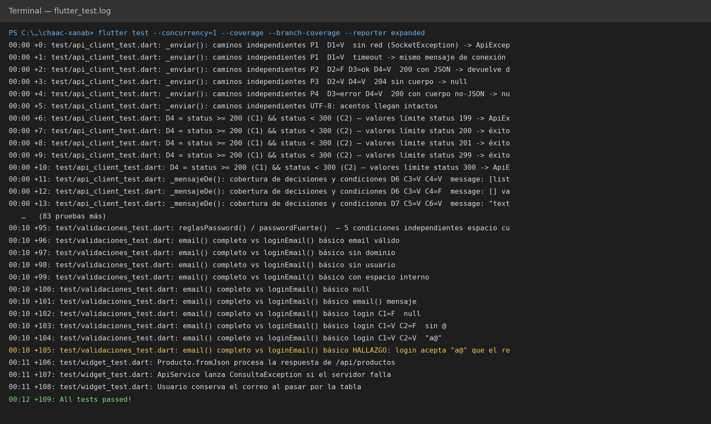

**Interpretación:** las 109 pruebas de la app pasan. Los nombres indican el camino (P#), la decisión (D#) y la condición (C#) que cada prueba fuerza, por ejemplo los límites 199/200/299/300 de `_enviar()`. Las marcadas como HALLAZGO pasan porque demuestran el defecto.

### C2. Aplicación móvil — cobertura de instrucciones y ramas

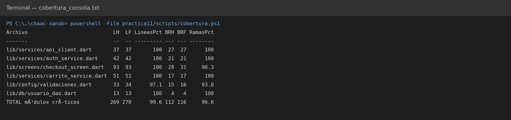

**Interpretación:** 99.6 % de instrucciones y 96.6 % de ramas en los módulos críticos, por encima de los objetivos (85 % y 80 %). Lo que falta está justificado en §2.4.

### C3. Aplicación móvil — análisis estático

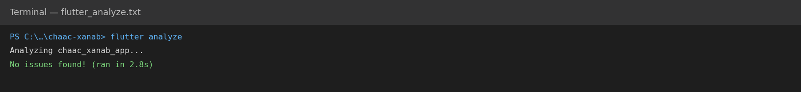

**Interpretación:** `flutter analyze` no reporta advertencias ni errores, ni en el código de la app ni en las pruebas nuevas.

### C4–C5. API — pruebas HTTP de los endpoints

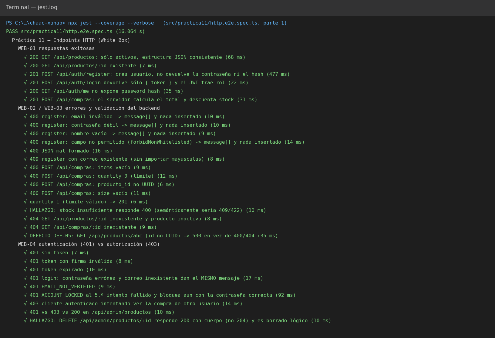

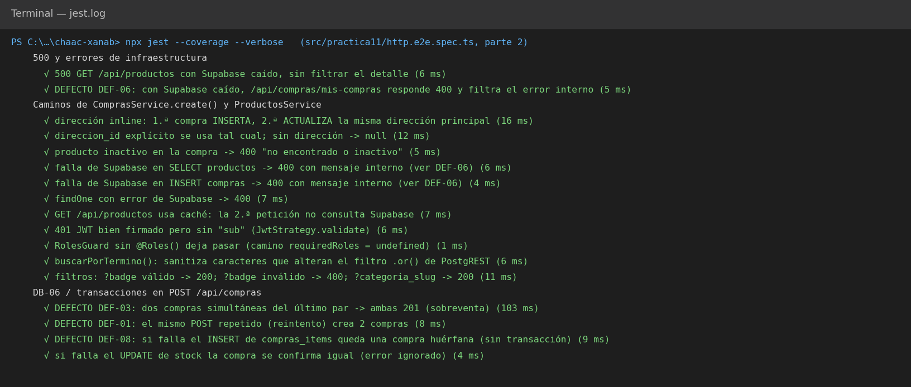

**Interpretación:** cada código HTTP de la tabla de la práctica (200, 201, 400, 401, 403, 404, 409, 500) se comprobó con los guards y el `ValidationPipe` reales. Se distingue 401 (sin sesión) de 403 (sin permiso). Las pruebas DEFECTO demuestran DEF-01, DEF-03, DEF-05, DEF-06 y DEF-08.

### C6. API — resumen y cobertura

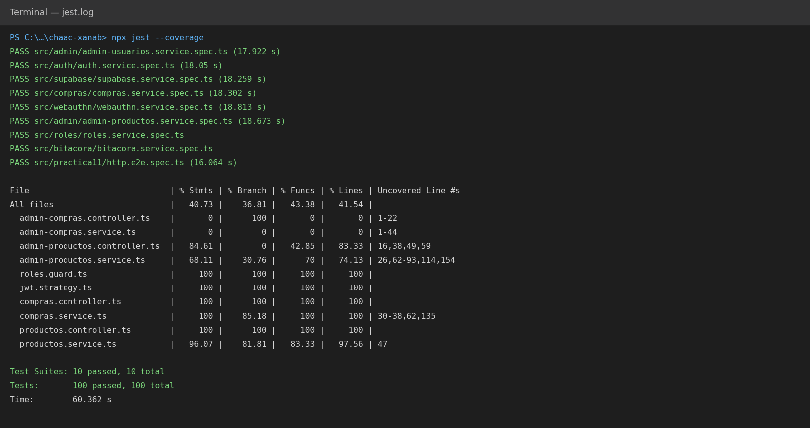

**Interpretación:** 100 de 100 pruebas aprobadas (antes de la práctica fallaban 13). Los módulos críticos (`compras`, `productos`, `roles.guard`, `jwt.strategy`) tienen entre 96 % y 100 % de instrucciones. El total del proyecto (40.7 %) es bajo porque hay módulos fuera del alcance.

### C7. API — vulnerabilidades de dependencias

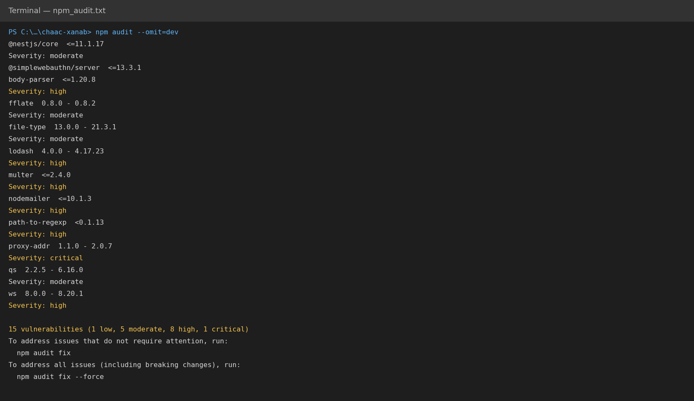

**Interpretación:** 1 crítica (`proxy-addr`) y 8 altas, que se reportan como DEF-11. Casi todas se corrigen con `npm audit fix` o actualizando NestJS, `multer` y `nodemailer`.

### C8. Conectividad — ping

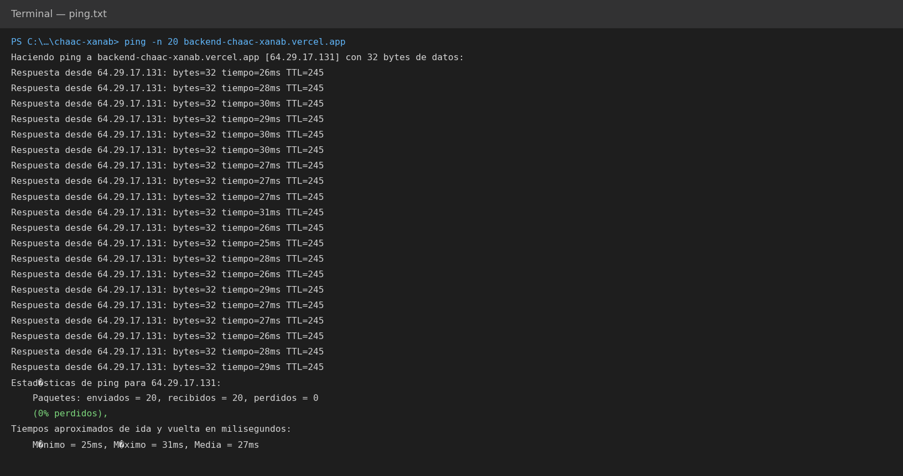

**Interpretación:** 20 de 20 paquetes, 0 % de pérdida y 25–31 ms (promedio 27.8). Es la latencia ICMP hasta el borde de Vercel; no incluye el procesamiento de la API.

### C9. Conectividad — códigos HTTP y 10 solicitudes en producción

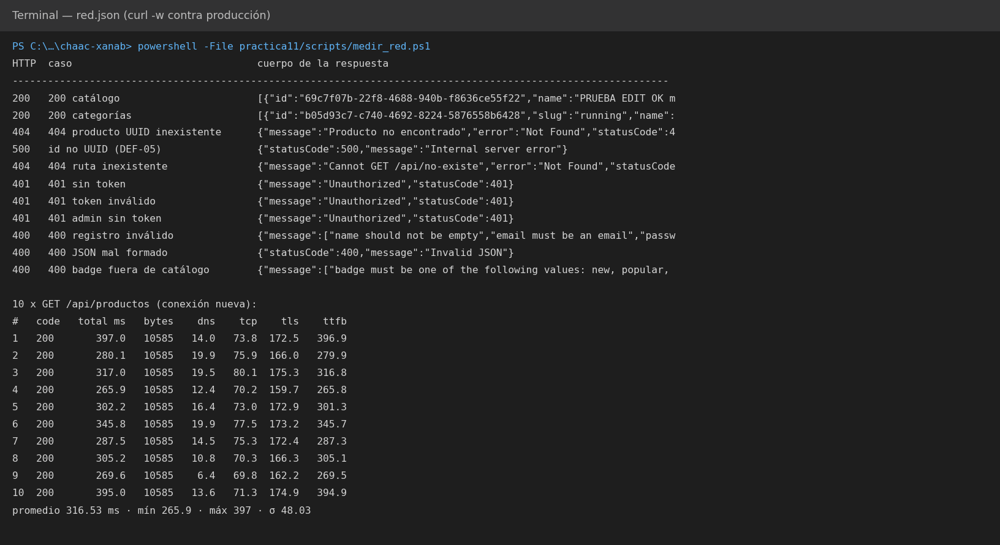

**Interpretación:** el servidor no responde siempre 200: cada caso inválido recibe su código. `GET /productos/abc` devuelve 500 en producción (DEF-05). Las 10 solicitudes responden 200 con el mismo tamaño (10,585 bytes) y tardan 316.5 ms en promedio; más de la mitad de ese tiempo se va en DNS, TCP y TLS.

### C10. Conectividad — prueba de carga

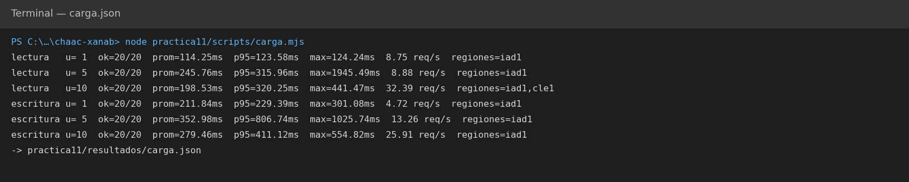

**Interpretación:** 120 de 120 respuestas correctas. El P95 se mantiene por debajo de 810 ms. El máximo de 1,945 ms con 5 usuarios corresponde al arranque en frío de una instancia nueva. Con 10 usuarios, Vercel atendió desde dos regiones (`iad1` y `cle1`).

### C11. Base de datos móvil — SQLite

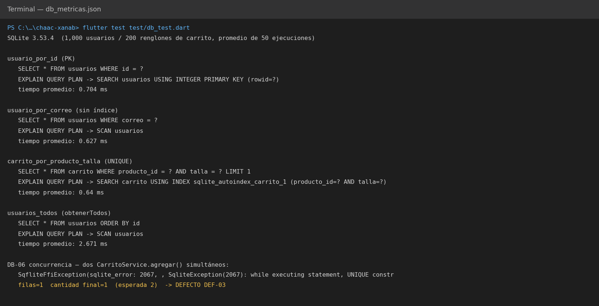

**Interpretación:** la búsqueda por PK y la del carrito usan índice (`SEARCH`), y la búsqueda por correo recorre toda la tabla (`SCAN`). Todas tardan menos de 3 ms. Dos `agregar()` simultáneos provocan un error UNIQUE y se pierde una pieza (DEF-03).

### C12. Base de datos del servidor — integridad en Supabase

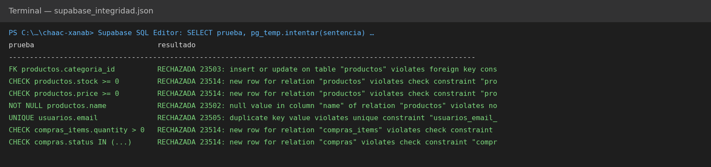

**Interpretación:** la base real rechaza llaves foráneas inexistentes, valores negativos, nulos, duplicados y estados no válidos, y todo se revierte. La integridad de los datos sí está protegida en el esquema.

### C13. Base de datos del servidor — planes de ejecución

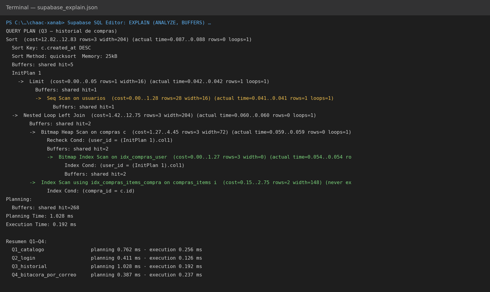

**Interpretación:** el historial de compras usa los índices `idx_compras_user` e `idx_compras_items_compra`. Las cuatro consultas se ejecutan en 0.13–0.26 ms, así que la base de datos no es el cuello de botella.

### C14. Base de datos del servidor — bitácora después de la prueba de carga

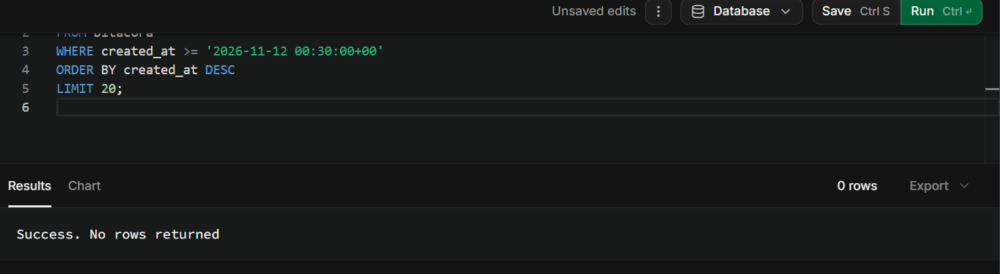

**Interpretación:** después de la prueba de carga (60 logins fallidos, todos con 401), la tabla `bitacora` no tiene ninguna fila nueva. Los intentos fallidos no quedaron auditados (DEF-12).

### C15. Sitio web — ejecución de las pruebas

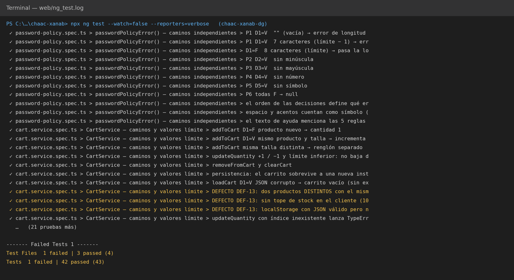

**Interpretación:** las 41 pruebas nuevas del sitio pasan. Las amarillas (DEFECTO DEF-13) pasan porque demuestran el defecto del carrito. La única falla es la spec que Angular generó por defecto: prueba la clase `App`, que el sitio no usa (OBS-10).

### C16. Sitio web — cobertura

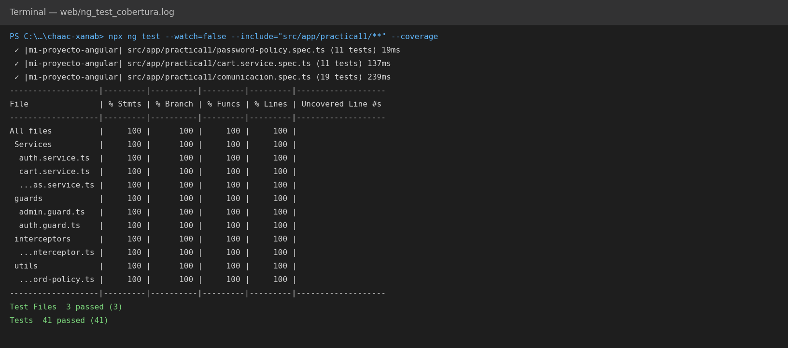

**Interpretación:** validación, carrito, `AuthService`, interceptor, guards y `ComprasService` quedan cubiertos al 100 % de instrucciones, ramas y funciones.

### C17. Sitio web — mediciones en producción

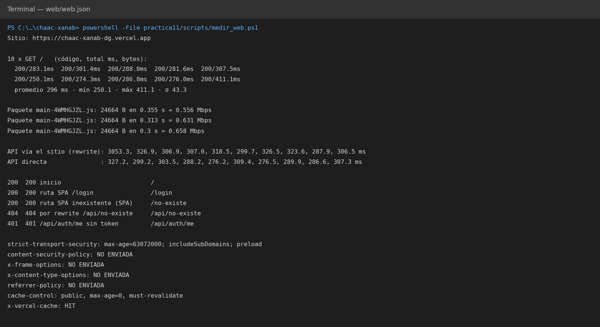

**Interpretación:** la página responde 10 de 10 veces con 200 en 296 ms de promedio. La API vía el sitio cuesta unos 15 ms más que la directa, salvo la 1.ª petición, que tardó 3,053 ms por un arranque en frío. Una ruta inexistente responde 200 en lugar de 404 (OBS-11), y el sitio no envía CSP, `X-Frame-Options` ni `X-Content-Type-Options` (DEF-09).
