# Práctica 12 — Optimización, pruebas de estrés y resiliencia · CHAAC XANAB

Continuación de la Práctica 11. Todas las cifras salen de ejecuciones reales guardadas en `practica12/resultados/` (app) y `backend-chaac-xanab/practica12/` (API). Las versiones **ANTES** y **DESPUÉS** se midieron en el mismo equipo, contra la misma base de datos de Supabase, con los mismos scripts y parámetros.

## 0. Entorno y versiones

| Elemento | Valor |
|---|---|
| Fecha | 2026-11-12 y 2026-11-13 (UTC-6) |
| Equipo cliente / servidor local | Lenovo 20L7002CUS · i7-8650U (8 hilos) · 16 GB · Windows 11 Pro 10.0.26200 · Wi-Fi |
| App (Flutter 3.44.0, modo **profile**, Windows) | ANTES: `b59f29b^` (rama `main` + URL configurable) · DESPUÉS: rama `practica12` |
| API NestJS | ANTES: commit `bbf3f21` (worktree aparte, puerto **3001**) · DESPUÉS: rama `practica12` (puerto **3000**) · ambas en `node dist/src/main.js` |
| Base de datos | PostgreSQL en Supabase (la misma para ANTES y DESPUÉS); acceso con la *service role* desde la API |
| Producción (solo lectura y medición) | `https://backend-chaac-xanab.vercel.app/api` (Vercel, región iad1) |
| Datos de prueba | usuario `p12.carga@example.invalid` y producto “P12 PRUEBA DE CARGA” (stock 100,000), creados y borrados con `backend/practica12/datos_prueba.js` |

**Cómo reproducir**
```powershell
# Backend (en cada versión):  $env:PORT='3001'; node dist/src/main.js
node practica12/scripts/estres.mjs --base http://localhost:3001/api --tipo escritura --usuarios 1,5,10,25,50 --solicitudes 100 --etiqueta antes
node practica12/scripts/estres.mjs --base http://localhost:3000/api --tipo escritura --usuarios 1,5,10,25,50 --solicitudes 100 --etiqueta despues --idempotencia
powershell -File practica12/scripts/muestrear.ps1 -Puerto 3000 -Segundos 300 -Salida practica12/resultados/estres/servidor.csv
flutter drive --profile -d windows --dart-define=API_URL=http://localhost:3000/api --driver=test_driver/perfil_driver.dart --target=integration_test/perfil_test.dart
node practica12/scripts/servidor_fallas.mjs --puerto 3100 --destino http://localhost:3000
flutter test test_resiliencia/res_despues_test.dart --dart-define=API_URL=http://localhost:3100/api --dart-define=BACKEND_URL=http://localhost:3000/api
node ../backend-chaac-xanab/practica12/db_pruebas.js despues practica12/resultados/db/db_despues.json
python practica12/scripts/comparar.py
```

---

## 1. Fase 1 — Recuperación de resultados de la auditoría anterior

| # | Problema seleccionado (Práctica 11) | Hipótesis técnica | Resultado |
|---|---|---|---|
| H1 | **Método de alta complejidad:** `ComprasService.create()` (V(G) ≈ 15) | La latencia de la compra está dominada por **6 + N viajes secuenciales** a Supabase (dirección ×2, productos, cabecera, renglones, un `UPDATE` de stock por producto). Ponerlos en **una función transaccional** reduce el tiempo unas 5 veces y elimina la condición de carrera | **Confirmada:** 564.6 → 106.1 ms (−81 %) |
| H2 | **Endpoint con latencia elevada:** `POST /api/compras` (≈ 565 ms con 1 usuario) y `GET /compras/mis-compras` (205 ms, 287 KB) | La compra se ralentiza por H1; el historial, porque transfiere y serializa **todas** las compras del usuario | **Confirmada:** historial 205.0 → 96.7 ms y 286,830 → 5,741 bytes |
| H3 | **Consulta optimizable:** historial `WHERE user_id = ? ORDER BY created_at DESC` | Con `idx_compras_user`, PostgreSQL lee **todas** las compras del usuario y luego las ordena; un índice compuesto `(user_id, created_at DESC)` entrega las primeras 20 ya ordenadas | **Confirmada:** 507 filas + *top-N heapsort* (11.95 ms) → recorrido del índice sin ordenar (0.64 ms) |
| H4 | **Conectividad/recuperación:** sin reintentos ni idempotencia (DEF-01) y timeout de 20 s | Reintentos con *exponential backoff* sólo en operaciones seguras, más una llave de idempotencia por compra: el sistema se recupera solo y **no duplica** compras | **Confirmada:** RES-07 y RES-08, de 2 compras a 1; RES-06 se recupera sin intervención; timeout de 20 a 10 s |
| H5 | **Riesgo de memoria/CPU:** descargar, parsear y pintar el historial completo (> 500 compras) en el hilo de UI | La paginación reduce el tiempo de apertura, el costo de construcción de frames y el CPU; el efecto en RAM será menor porque el motor de Flutter y las imágenes dominan la memoria | **Confirmada en tiempo y CPU** (abrir pedidos −73 %, CPU −33 %, p99 de *build* 8.72 → 1.60 ms); **RAM sin cambio relevante** (−1.3 %) |

**Re-verificación de la Práctica 11.** DEF-12 (la bitácora no guardó las 60 filas de la prueba de carga) **no se reprodujo**: un login fallido nuevo contra producción quedó registrado (`LOGIN_FALLIDO`, 187.243.208.226, 2026-11-13 03:46:47 UTC). Se reclasificó como *no reproducible* en el informe de la Práctica 11.

---

## 2. Fase 2 — Profiling y diagnóstico de la aplicación móvil

**Herramientas.** `integration_test` (`integration_test/perfil_test.dart`) maneja la app real compilada en **modo profile** en Windows. Mide el tiempo de cada operación con `Stopwatch` y las estadísticas de frames con `watchPerformance` (build/raster, p90/p99, frames que exceden 16 ms). En paralelo, `practica12/scripts/muestrear.ps1` registra el **CPU (%) y la RAM (MB)** del proceso `chaac_xanab_app.exe` cada 500 ms. CPU 100 % = los 8 hilos de la máquina.

**Las 6 pruebas obligatorias** se ejecutaron en este orden: inicio de sesión → (1) consulta repetida ×10 (recargar catálogo) → (4) procesamiento: filtro de búsqueda, 27 pulsaciones → (3) navegación ×3 entre Carrito, Pedidos, Perfil y Tienda, con scroll del historial → (2) escritura: agregar al carrito (SQLite) y confirmar compra (API) ×2 → (5) CPU/RAM y (6) frames durante todo el recorrido.

### 2.1 Tiempo por operación (ms, promedio)

| Operación | n | ANTES | DESPUÉS | Diferencia |
|---|---|---|---|---|
| **Confirmar compra** (POST /compras + diálogo) | 2 | **1,135.0** (673 / 1,597) | **158.0** | **−86.1 %** |
| **Abrir “Pedidos” por primera vez** (descarga del historial) | 1 | **1,052.0** | **289.0** | **−72.5 %** |
| Abrir “Pedidos” (ya cargado) | 2 | 41.5 | 39.5 | −4.8 % |
| Recargar catálogo | 10 | 83.3 | 86.4 | +3.7 % (sin cambio; no se optimizó) |
| Filtro de búsqueda (por tecla) | 27 | 32.7 | 31.1 | −4.9 % |
| Agregar al carrito (SQLite) | 2 | 42.0 | 41.0 | −2.4 % |
| Ir a Carrito / Perfil / Tienda | 3 c/u | 45.0 / 48.7 / 34.0 | 46.3 / 38.7 / 33.3 | ≈ igual |
| Inicio de sesión | 1 | 2,383 | 986 | no atribuible: el login no se modificó; la 1.ª petición incluye arranque en frío |

> El usuario P12 tenía **507 compras** en la corrida ANTES y **más de 1,000** en la DESPUÉS: la apertura de Pedidos mejoró aun con el doble de datos.

### 2.2 Frames (watchPerformance)

| Fase | Frames A → D | *Build* p90 (ms) | *Build* p99 (ms) | *Raster* p99 (ms) | Frames > 16 ms |
|---|---|---|---|---|---|
| Consulta | 49 → 60 | 1.79 → 1.74 | 3.36 → 3.30 | 7.09 → 5.78 | 0 → 0 |
| Procesamiento | 98 → 101 | 2.75 → 2.52 | 3.95 → 3.23 | 6.77 → 7.76 | 1 → 1 |
| **Navegación** (incluye historial) | 731 → 574 | **7.04 → 1.03** | **8.72 → 1.60** | 2.83 → 2.21 | 2 → 2 |
| Escritura | 418 → 323 | 0.91 → 1.04 | 5.78 → 4.00 | 3.80 → 2.06 | 0 → 0 |

**Bloqueos de UI:** no hubo congelamientos; los 3 frames lentos son de *raster* durante animaciones. El mayor costo de *build* estaba en construir el historial completo, y la paginación lo eliminó.

### 2.3 CPU y memoria del proceso de la app

| Métrica | ANTES | DESPUÉS | Diferencia |
|---|---|---|---|
| CPU promedio (% de la máquina) | 3.86 % | 2.57 % | **−33.4 %** |
| CPU máximo | 10.26 % | 6.96 % | −32.2 % |
| RAM inicial / máxima / final (MB) | 75.3 / 225.7 / 225.7 | 75.1 / 222.7 / 222.0 | máx. −1.3 % |

**Diagnóstico.** El componente que más recursos consumía era **el historial de pedidos**: se descargaban y construían más de 500 tarjetas con imágenes. La operación más lenta era **la compra**, por la espera de red de 6 o más viajes secuenciales. La RAM casi no cambia: la mayor parte son el motor de Flutter, las fuentes y la caché de imágenes, no los datos.

> **Fallo intermitente observado (no reproducido):** en 1 de 4 corridas del perfil DESPUÉS, la segunda compra se **registró en el servidor** (verificado en la tabla `compras`), pero el guion no vio el diálogo de éxito en 40 s. Las 3 corridas siguientes pasaron completas. Se documenta como P12-D7.

---

## 3. Fase 3 — Pruebas de estrés del sitio web y API

**Script:** `practica12/scripts/estres.mjs`, reproducible y sin dependencias. Corre etapas de U usuarios concurrentes con 100 solicitudes por etapa, más una de calentamiento que no se cuenta, y reporta RPS, promedio, P50/P90/P95/P99, máximo, % de errores y códigos HTTP. **Endpoints:** lectura `GET /api/productos`; escritura `POST /api/compras`, que crea compras reales del producto de prueba. El comportamiento del servidor (CPU/RAM del proceso Node) se muestreó con `muestrear.ps1`.

### 3.1 Escritura — `POST /api/compras`

| Usuarios | RPS A → D | Promedio (ms) A → D | P90 (ms) A → D | P95 (ms) A → D | Máx. (ms) A → D | Errores |
|---|---|---|---|---|---|---|
| 1 | 1.77 → **9.43** | 564.61 → **106.07** | 614.34 → 122.20 | 645.35 → **129.81** | 962.43 → 196.65 | 0 % → 0 % |
| 5 | 8.53 → 39.37 | 579.50 → 125.01 | 672.77 → 190.51 | 776.29 → 226.32 | 931.75 → 322.38 | 0 % → 0 % |
| 10 | 16.22 → 79.74 | 591.49 → 120.23 | 646.19 → 164.58 | 694.47 → 199.08 | 820.20 → 311.15 | 0 % → 0 % |
| 25 | 35.53 → **133.48** | 650.92 → 167.51 | 804.99 → 278.59 | 826.38 → 348.58 | 958.18 → 472.34 | 0 % → 0 % |
| 50 | 45.63 → 90.92 | 969.92 → 438.49 | 1,149.43 → 750.46 | 1,201.10 → 1,028.85 | 1,352.68 → 1,077.68 | 0 % → 0 % |

Códigos: **100 % `201`** en todas las etapas, antes y después.

### 3.2 Lectura — `GET /api/productos` (control: no se modificó)

| Usuarios | Local A: RPS / prom / P95 (ms) | Local D: RPS / prom / P95 (ms) | Producción (Vercel): RPS / prom / P95 / máx (ms) |
|---|---|---|---|
| 1 | 428.2 / 2.33 / 4.03 | 705.3 / 1.41 / 2.58 | 9.3 / 107.7 / 141.6 / 527.4 |
| 5 | 1,438.2 / 3.41 / 6.01 | 1,124.7 / 4.33 / 9.14 | 30.9 / 160.8 / 252.6 / 1,903.8 |
| 10 | 1,456.1 / 6.64 / 13.96 | 1,232.5 / 7.59 / 14.55 | 77.1 / 118.0 / 237.5 / 305.5 |
| 25 | 1,507.3 / 15.13 / 31.34 | 1,048.2 / 22.14 / 41.42 | 46.9 / 212.5 / 438.7 / 2,089.9 |
| 50 | 1,118.5 / 35.28 / 62.56 | 1,390.0 / 29.48 / 52.41 | 47.8 / 297.1 / 1,743.7 / 2,082.8 |
| 100 | 1,467.3 / 40.76 / 50.29 | 1,559.1 / 36.42 / 45.67 | — |

0 % de errores en todos los casos. Las variaciones locales entre A y D (±20 %) son ruido de una lectura servida desde la caché en memoria: misma meseta de unas 1,100–1,560 RPS y mismo crecimiento de la latencia.

### 3.3 Historial — `GET /api/compras/mis-compras` (sin paginar → `?limite=20`)

| Usuarios | RPS A → D | Promedio (ms) A → D | P95 (ms) A → D | Bytes por respuesta |
|---|---|---|---|---|
| 1 | 4.88 → 10.34 | 205.03 → 96.67 | 256.41 → 118.89 | **286,830 → 5,741 (−98 %)** |
| 5 | 21.82 → 42.43 | 217.28 → 109.46 | 292.69 → 172.80 | |
| 10 | 36.43 → 70.92 | 242.19 → 121.39 | 374.24 → 199.72 | |
| 25 | 47.26 → 98.04 | 407.60 → 214.98 | 594.57 → 363.16 | |

### 3.4 Comportamiento del servidor (proceso Node local, % de la máquina)

| Prueba | CPU prom. A → D | CPU máx. A → D | RAM máx. (MB) A → D |
|---|---|---|---|
| Escritura | 1.69 → 2.48 | 7.30 → 11.21 | 190.8 → 154.5 |
| Lectura | 1.22 → 1.52 | 3.03 → 2.66 | 116.0 → 151.8 |

En escritura, el CPU promedio sube porque el servidor atiende **casi 3 veces más compras por segundo**. Por compra, el costo baja: el trabajo pesado (transacción y stock) lo hace PostgreSQL y Node ya no orquesta 6 o más llamadas. El servidor nunca se acercó a saturar su CPU, así que el límite no está en Node.

### 3.5 Pregunta técnica: ¿crecimiento proporcional o punto de saturación?

**Hay punto de saturación; el crecimiento no es proporcional.**
- **Lectura local:** el RPS llega a una **meseta de unas 1,450** desde los 5 usuarios. A partir de ahí, cada usuario adicional sólo agrega espera en cola, y la latencia crece casi linealmente con los usuarios (3.4 → 40.8 ms de 5 a 100). Es la ley de Little: con el *throughput* fijo, más concurrencia = más tiempo en cola.
- **Escritura ANTES:** la latencia se mantiene casi plana hasta 25 usuarios (565 → 651 ms) porque el tiempo es de espera de red y no de trabajo; con 50 usuarios se dispara (970 ms) y el RPS se estanca en unos 45. **Saturación ≈ 45 compras/s.**
- **Escritura DESPUÉS:** escala casi linealmente hasta 25 usuarios (9 → 133 RPS con la latencia casi constante) y **se satura alrededor de 25–50 usuarios**. Con 50, el RPS **baja** a 91 y el P95 sube a 1,029 ms. La causa es el **bloqueo de fila**: todas las compras descuentan stock del **mismo producto**, así que PostgreSQL serializa los `UPDATE` sobre esa fila. Es el precio de la consistencia (antes no había espera, pero se perdía el 69 % de los descuentos).
- **Producción (Vercel):** no hay errores; Vercel abre instancias nuevas, pero los **arranques en frío** generan colas de 1.7–2.1 s en el P95 y el máximo desde 5 usuarios, y el RPS se estanca en unos 47 con 25–50 usuarios.

---

## 4. Fase 4 — Pruebas avanzadas de base de datos

`backend/practica12/db_pruebas.js` ejecuta las consultas contra Supabase con PostgREST y mide desde este equipo, es decir, **red + PostgREST + PostgreSQL**. Los planes de ejecución reales se obtuvieron en el SQL Editor (`practica12/sql/optimizacion.sql`).

### 4.1 Resultados

| # | Prueba | Filas | Bytes | ANTES prom / P95 (ms) | DESPUÉS prom / P95 (ms) |
|---|---|---|---|---|---|
| 1 | Por identificador (`productos.id`) | 1 | 113 | 117.17 / 189.76 | 103.08 / 124.40 |
| 2 | Conjunto pequeño (10 productos recientes) | 10 | 915 | 192.06 / 468.60 | 100.57 / 155.93 |
| 3 | Conjunto grande: historial completo P12 | **503 → 1,000** | 144,307 → 286,880 | 166.48 / 426.95 | 201.20 / 237.54 |
| 3b | Historial paginado (20) | 20 | 5,739 | 129.84 / 227.40 | 183.19 / 609.79 |
| 4 | Con filtros (activo, rango de precio, `ILIKE`, orden) | 17 | 1,530 | 100.75 / 180.84 | 97.17 / 114.41 |
| 5 | **50 descuentos simultáneos del mismo stock** | — | — | **48 perdidos de 50** (2 aplicados) · 1,375.9 ms | **0 perdidos** (50 aplicados) · 504.0 ms |
| 6 | Dos `UPDATE` simultáneos del estado de la misma compra | 1 | — | válido (gana la última) | válido (gana la última) |

**Lectura de los tiempos.** Las consultas 1, 2, 3b y 4 están dominadas por la red: **≈ 100 ms por viaje** a Supabase desde Mérida. Medidas desde el cliente, la variación entre corridas (P95 de hasta 610 ms) es mayor que la ganancia del índice, que es de unos 11 ms. Por eso la mejora de la consulta se evalúa con **EXPLAIN ANALYZE** en el servidor (4.3).

### 4.2 Análisis obligatorio

| Aspecto | Hallazgo |
|---|---|
| Tiempo y registros | Ver tabla 4.1. |
| Uso de índices | `productos.id` → PK. Historial ANTES → `idx_compras_user` + *sort*; DESPUÉS → `idx_compras_usuario_fecha` sin *sort* (4.3). Búsqueda de usuario por correo → `Seq Scan` (37 filas, 1 página; lo correcto a esta escala). |
| Bloqueos o esperas | DESPUÉS, los `UPDATE` atómicos sobre la misma fila **esperan su turno** (bloqueo de fila): es lo que garantiza 0 descuentos perdidos y lo que limita el RPS con 50 usuarios (3.5). |
| **Consultas repetidas innecesariamente** | ANTES, cada compra hacía **6 + N** viajes (`SELECT` dirección, `UPDATE`/`INSERT` dirección, `SELECT` productos, `INSERT` compra, `INSERT` renglones, `UPDATE` stock × N); DESPUÉS, **1** (`rpc crear_compra`). La app volvía a descargar el historial completo cada vez que se abría la pestaña Pedidos; ahora pide 20. |
| **Problemas de concurrencia** | ANTES: *lost update* (leer → calcular → escribir). En la prueba de estrés se vendieron 501 piezas y el stock sólo bajó 153 (**348 descuentos perdidos, 69 %**); en la prueba 5, 48 de 50. DESPUÉS: 0 perdidos. |
| **Integridad después de las operaciones** | ANTES: `stock_real − stock_esperado = +348`. DESPUÉS: **diferencia 0** (1,009 piezas vendidas, stock 98,991 = 100,000 − 1,009), **0 compras huérfanas**. |
| **Hallazgo nuevo** | El historial sin límite devolvió **exactamente 1,000 filas** con 1,009 compras: PostgREST (Supabase) corta las respuestas en 1,000 filas por defecto. El endpoint original **ocultaba en silencio** las compras más antiguas a cualquier usuario con más de 1,000 pedidos (P12-D2). |

### 4.3 Consulta optimizada: historial paginado (índice compuesto)

```sql
SELECT id, total, status, created_at FROM compras
WHERE user_id = <P12> ORDER BY created_at DESC LIMIT 20;
```

| | ANTES (bloque A) | DESPUÉS (bloque C) |
|---|---|---|
| Índice | `idx_compras_user (user_id)` | `idx_compras_usuario_fecha (user_id, created_at DESC)` |
| Plan | `Index Scan` lee **507 filas** → `Sort … top-N heapsort` → `Limit 20` | recorre el índice ya ordenado y se detiene en la fila 20 (sin `Sort`) |
| Tiempo del nodo `Limit` | **11.945 ms** | **0.640 ms** (−94.6 %) |
| *Execution Time* | 12.036 ms | (fuera del área visible de la captura) |

El costo ANTES crece con el número de compras del usuario, porque las ordena todas; el DESPUÉS es prácticamente constante. Bloque D (200,000 compras sintéticas en tablas temporales): la captura sólo muestra la fase “sin índice compuesto” (`Limit` 0.361 ms, *top-N heapsort*, 100 filas por usuario); la fase “con índice” no quedó visible y no se reporta. Evidencia: `capturas/sql_A_antes.png`, `sql_C_despues.png`, `sql_D_escala.png`, `resultados/db/explain_A_antes.json`.

**Técnicas aplicadas** (de la lista de la práctica): agregar índices (`idx_compras_usuario_fecha`, `uq_compras_usuario_idem`), paginación, reducir consultas repetidas (6 + N → 1), transacción (`crear_compra`) y recuperar sólo los campos necesarios (página de 20 en lugar de todo).

---

## 5. Fase 5 — Pruebas de resiliencia y recuperación

**Método.** `practica12/scripts/servidor_fallas.mjs` es un proxy real entre la app y el backend que provoca fallas a nivel de socket: cortar la conexión, colgarse, responder tarde, devolver 500/401/403, apagarse (ECONNREFUSED) o **procesar la operación y cortar antes de responder**. `test_resiliencia/` ejecuta los escenarios con el código real de la app (`ApiClient`, `TiendaService`) y cuenta las compras directamente en el servidor.

### 5.1 Matriz de pruebas de resiliencia

| Código | Escenario | Esperado | ANTES | DESPUÉS |
|---|---|---|---|---|
| RES-01 | Pérdida de Internet durante una consulta | Error controlado | ✔ error en **99 ms**, sin reintento | ✔ error en **1,790 ms** tras **2 reintentos** con backoff |
| RES-02 | Pérdida de Internet durante una escritura | No confirmar falsamente | ✔ error en 8 ms · 0 compras | ✔ error en 1,961 ms (2 reintentos con la misma llave) · 0 compras |
| RES-03 | Servidor sin respuesta | Timeout controlado | ✔ pero tarda **20,002 ms** | ✔ **10,002 ms**, marcado `porTimeout` (no se reintenta) |
| RES-04 | Respuesta HTTP 500 | Error y estabilidad | ✔ 7 ms; la siguiente consulta funciona | ✔ 5 ms; la siguiente consulta funciona |
| RES-05 | 401 / 403 | Autenticación vs. permisos | ✔ 401 cierra sesión; 403 la conserva | ✔ igual |
| RES-06 | Recuperación de conexión (servidor apagado 3 s) | Restablecer comunicación | ⚠ **sin reintento automático**: el 1.er intento falla (2,024 ms) y hay que reintentar **a mano** | ✔ **recuperación automática** en 3,157 ms con 1 reintento, sin intervención |
| RES-07 | Reintento de una escritura cuya respuesta se perdió | Sin duplicados | ✘ **2 compras** | ✔ **1 compra**: el cliente reintenta solo con la misma llave y el servidor devuelve la original (`Idempotent-Replayed`) |
| RES-08 | Respuesta tardía (2.5 s) con doble envío | Sin duplicados | ✘ **2 compras** (a nivel de servicio; la UI ya bloquea el botón) | ✔ **1 compra** (misma llave) |

**ANTES 6/8 · DESPUÉS 8/8.** Evidencia: `resultados/resiliencia/res_antes.json`, `res_despues.json`.

### 5.2 Análisis requerido

- **¿Cuánto tarda en detectar una interrupción?** Si se corta la conexión, ANTES lo detecta al instante (8–99 ms) y DESPUÉS en unos 1.8–2.0 s, a propósito: hace 2 reintentos (≈ 0.5 s y ≈ 1 s) antes de rendirse, para absorber cortes breves. Si el servidor no responde, ANTES tarda 20 s y DESPUÉS 10 s. Si el servidor está apagado, Windows tarda unos 2 s en devolver ECONNREFUSED.
- **¿Qué pasa con una operación pendiente?** Queda esperando hasta respuesta o timeout. En la UI, el botón CONFIRMAR queda deshabilitado (`_pagando`) y el carrito no se vacía hasta tener la confirmación del servidor.
- **¿Se repite automáticamente?** ANTES nunca. DESPUÉS sí, **sólo** en GET y en el POST de compra con llave, ante fallas de conexión o 502/503/504; máximo 2 veces. Un **timeout no se reintenta solo**, porque el servidor pudo haber procesado la operación; se informa al usuario, y si reintenta, la llave evita el duplicado.
- **¿Puede generarse un registro duplicado?** ANTES sí (RES-07 y RES-08). DESPUÉS no: la llave es única por usuario (`uq_compras_usuario_idem`) y, si dos envíos con la misma llave llegan a la vez, el segundo choca con el índice único y recibe la compra ganadora.
- **¿Cómo se recupera la interfaz?** Muestra el mensaje de error, conserva el carrito y la dirección, y vuelve a habilitar el botón. En una consulta, ofrece “Reintentar”.
- **¿Y si el servidor procesa la operación pero la respuesta nunca llega?** ANTES: el usuario ve un error, reintenta y **paga dos veces**. DESPUÉS: el `ApiClient` reintenta con la misma llave, el servidor encuentra la compra existente y la devuelve con `Idempotent-Replayed: true`, y el usuario ve el éxito **una sola vez** (RES-07).

### 5.3 Reto: backoff exponencial e idempotencia (implementado)

| Pieza | Dónde | Detalle |
|---|---|---|
| Backoff exponencial con *jitter* | `lib/services/api_client.dart` | espera = 500 ms · 2^intento + azar(0–250 ms) → ~0.5 s y ~1 s; máximo 2 reintentos; sólo GET y POST con llave; sólo sin respuesta o 502/503/504 |
| Llave de idempotencia | `lib/screens/checkout_screen.dart` | 128 bits de `Random.secure()`, una por intento de compra, reutilizada en reintentos automáticos y manuales |
| Validación y respuesta | `compras.controller.ts` | `Idempotency-Key` de 8–100 caracteres `[A-Za-z0-9_-]`; si se repite, responde la compra original con `Idempotent-Replayed: true` |
| Garantía en la BD | `crear_compra` + `uq_compras_usuario_idem` | búsqueda por llave dentro de la transacción; índice único parcial `(user_id, idempotency_key)`; ante una carrera (23505) el backend repite la llamada y devuelve la compra ganadora |

---

## 6. Fase 6 — Optimización y comparación

### 6.1 Optimizaciones implementadas (código real del proyecto)

| ID | Optimización | Archivos | Problema que resuelve |
|---|---|---|---|
| **O1** | **Compra en una sola transacción** (`crear_compra`): descuento de stock atómico `UPDATE … SET stock = stock − n WHERE stock >= n`, renglones ordenados por producto (sin interbloqueos), dirección y total en el mismo viaje | `sql/optimizacion.sql` (B3, B4), `compras.service.ts` | Latencia de 6 + N viajes, *lost updates* (DEF-03), compras huérfanas (DEF-08) |
| **O2** | **Idempotencia + reintentos con backoff** | `api_client.dart`, `checkout_screen.dart`, `tienda_service.dart`, `compras.controller.ts`, `uq_compras_usuario_idem` | Duplicados al reintentar (DEF-01), recuperación manual |
| **O3** | **Historial paginado** con cursor por fecha + índice compuesto | `mis_compras_screen.dart`, `compras.service.ts` (`?limite&antes`), `idx_compras_usuario_fecha` | Respuesta de 287 KB, truncamiento silencioso a 1,000 filas, costo de UI |
| O4 | Errores con el código correcto (409 stock, 404 producto, 500 genérico) y `ParseUUIDPipe` | `compras.service.ts`, `compras.controller.ts` | DEF-06 y OBS-04 de la Práctica 11 |
| O5 | Timeout por intento de 20 a 10 s | `api_config.dart` | Detección lenta de un servidor colgado |
| — | Seguridad de las funciones: `REVOKE … FROM anon, authenticated` | `optimizacion.sql` (B5) | Que nadie con la llave pública invoque `crear_compra` vía `/rest/v1/rpc` |

### 6.2 Tabla comparativa antes y después (obligatoria)

| Métrica | Antes | Después | Diferencia |
|---|---|---|---|
| **Latencia promedio API (ms)** — `POST /compras`, 1 usuario | 564.61 | 106.07 | **−458.54 ms (−81.2 %)** |
| Latencia promedio API (ms) — `POST /compras`, 25 usuarios | 650.92 | 167.51 | −483.41 ms (−74.3 %) |
| **P95 API (ms)** — 1 usuario | 645.35 | 129.81 | **−515.54 ms (−79.9 %)** |
| P95 API (ms) — 25 usuarios | 826.38 | 348.58 | −477.80 ms (−57.8 %) |
| **RPS** (máximo sostenido de escritura) | 45.63 (50 usuarios) | 133.48 (25 usuarios) | **+87.85 (+192.5 %)** |
| **Errores (%)** | 0 % | 0 % | 0 (sin degradación) |
| **Tiempo de consulta DB (ms)** — historial `LIMIT 20` (EXPLAIN, nodo `Limit`) | 11.945 | 0.640 | **−11.305 ms (−94.6 %)** |
| **RAM máxima (MB)** — app | 225.7 | 222.7 | −3.0 MB (−1.3 %) |
| **CPU promedio (%)** — app | 3.86 | 2.57 | **−1.29 pp (−33.4 %)** |
| **Tiempo de operación crítica (ms)** — confirmar compra en la app | 1,135.0 | 158.0 | **−977.0 ms (−86.1 %)** |
| Descuentos de stock perdidos (estrés de escritura) | 348 de 501 (69 %) | 0 de 502 | **−100 %** |
| Descuentos perdidos (50 simultáneos, prueba DB 5) | 48 de 50 | 0 de 50 | −100 % |
| Compras duplicadas al reintentar (RES-07 / RES-08) | 2 / 2 | 1 / 1 | sin duplicados |
| Tamaño de la respuesta del historial | 286,830 B | 5,741 B | −98.0 % |
| Abrir “Pedidos” en la app (1.ª vez) | 1,052 ms | 289 ms | −72.5 % |
| Escenarios de resiliencia aprobados | 6 / 8 | 8 / 8 | +2 |

### 6.3 Ausencia de defectos nuevos

- **App:** `flutter analyze` sin problemas; **111/111** pruebas (las 109 de la Práctica 11 más 2 nuevas). NET-05 se ajustó porque ahora la compra se reintenta 2 veces con la misma llave antes de mostrar el error.
- **API:** la suite completa pasa: **10 suites, 103/103 pruebas** (`backend/practica12/jest_p12.log`). Las pruebas de la Práctica 11 que **demostraban** DEF-01/03/06/08 se convirtieron en **pruebas de regresión** que exigen el comportamiento corregido: 409/404/500, sin sobreventa, *rollback* completo, misma compra con la misma llave.
- **Compatibilidad:** el sitio web Angular sigue funcionando sin cambios. Envía `POST /compras` sin llave (se acepta) y `GET mis-compras` sin `limite` (responde como antes).
- **Integridad:** diferencia de stock 0 y 0 compras huérfanas tras 502 compras concurrentes.

---

## 7. Resultados de rendimiento (PER-01 … PER-11)

| ID | Métrica | Resultado | Evidencia |
|---|---|---|---|
| PER-01 | CPU de la app: promedio y máximo | ANTES 3.86 % / 10.26 % → DESPUÉS **2.57 % / 6.96 %** | `perfil/app_antes.csv`, `app_despues.csv` |
| PER-02 | Memoria: RAM inicial, máxima y final | ANTES 75.3 / 225.7 / 225.7 MB → DESPUÉS 75.1 / 222.7 / 222.0 MB (sin cambio relevante) | ídem |
| PER-03 | Tiempo de operación (ms) | Compra 1,135 → **158**; abrir Pedidos 1,052 → **289**; filtro 32.7 → 31.1; carrito 42 → 41 | `perfil/perfil_antes.json`, `perfil_despues.json` |
| PER-04 | Carga API: RPS y solicitudes exitosas | Escritura: máx. 45.6 → **133.5** RPS; 100 % `201` (1,000/1,000). Lectura: meseta ≈ 1,450 RPS local, ≈ 47–77 en producción; 100 % `200` | `estres/*.json` |
| PER-05 | Latencia API: promedio, P90, P95 | Escritura 1 usuario: 564.6 / 614.3 / 645.4 → **106.1 / 122.2 / 129.8** ms | `estres/escritura_*.json` |
| PER-06 | Errores HTTP | **0 de 3,020 solicitudes** de estrés (0 %); códigos 200/201 únicamente | `estres/*.json` |
| PER-07 | Consultas DB: tiempo y registros | Historial `LIMIT 20`: 11.95 → **0.64 ms** (507 → 20 filas leídas); 1 / 10 / 17 filas en ≈ 100 ms desde el cliente | `db/*.json`, capturas SQL |
| PER-08 | Concurrencia DB: conflictos y consistencia | ANTES 348/501 y 48/50 descuentos perdidos → DESPUÉS **0**; diferencia de stock **0**; 0 huérfanas | `estres/integridad_*.json`, `db/*.json` |
| PER-09 | Pérdida de conexión: detección y manejo | Corte: 99 ms → 1.8 s (2 reintentos); servidor colgado: **20 → 10 s**; nunca confirma falsamente | `resiliencia/*.json` |
| PER-10 | Recuperación: tiempo y consistencia posterior | ANTES manual; DESPUÉS **automática en 3.2 s**; RES-07/08 sin duplicados | `resiliencia/res_despues.json` |
| PER-11 | Optimización: antes y después | Ver §6.2: compra −81 %, RPS +193 %, consulta −95 %, CPU app −33 %, 0 inconsistencias | `comparativa.json` |

---

## 8. Registro de defectos y correcciones

| ID | Componente | Severidad | Defecto | Estado / corrección |
|---|---|---|---|---|
| P12-D1 | API + BD (`compras.service.ts`) | **Crítica** | *Lost updates* de stock bajo concurrencia: 348 de 501 descuentos perdidos (69 %); 48 de 50 en la prueba directa | **Corregido (O1):** `UPDATE` atómico dentro de `crear_compra`; 0 perdidos |
| P12-D2 | API (PostgREST) | Alta | `GET mis-compras` sin límite corta en silencio en 1,000 filas: un usuario con 1,009 compras no ve 9 | **Corregido en la app (O3)** con paginación; el sitio web aún pide todo: se recomienda paginarlo igual |
| P12-D3 | App + API | Alta | Reintentar una compra cuya respuesta se perdió la duplica (RES-07, RES-08) | **Corregido (O2):** llave de idempotencia + índice único |
| P12-D4 | API | Media | Compra sin transacción: cabecera huérfana si falla un renglón (DEF-08) | **Corregido (O1):** *rollback* completo (prueba de regresión) |
| P12-D5 | App | Media | Sin recuperación automática ante cortes breves (RES-06) y detección de servidor colgado en 20 s | **Corregido (O2, O5):** backoff exponencial y timeout de 10 s |
| P12-D6 | BD | Media (riesgo) | Con 50 compras simultáneas del **mismo** producto, el bloqueo de fila limita a ≈ 91 RPS (P95 1.03 s) | **Abierto.** Aceptable para el volumen actual; si un producto se vuelve “caliente” (preventa), usar reserva de stock por lotes o una cola de pedidos |
| P12-D7 | App (profiling) | Baja | En 1 de 4 corridas, la compra se registró en el servidor pero el guion no vio el diálogo de éxito en 40 s | **Abierto, no reproducido.** Se recomienda registrar el resultado de `_confirmar()` para cazarlo si reaparece |
| P11 DEF-12 | API (bitácora) | — | La bitácora no guardó los logins fallidos de la prueba de carga | **Reclasificado: no reproducible** (producción sí registró el login fallido nuevo) |

---

## 9. Conclusiones técnicas

El cuello de botella de CHAAC XANAB no estaba en el CPU del servidor ni en la potencia de PostgreSQL, sino en **cómo se usaba la red hacia la base de datos**. Cada consulta a Supabase cuesta unos 100 ms de viaje desde Mérida, mientras que ejecutarla en el motor tarda menos de 1 ms (0.13–0.26 ms en la Práctica 11; 0.64 ms el historial con el índice nuevo). La compra hacía 6 + N viajes en serie, por lo que su tiempo (565 ms) era casi pura espera. Al convertirla en una sola función transaccional (`crear_compra`), la latencia bajó 81 % (106 ms), el RPS sostenido casi se triplicó (45.6 → 133.5) y el tiempo que percibe el usuario al confirmar una compra pasó de 1,135 a 158 ms.

La prueba de estrés reveló algo más grave que la lentitud: la versión original **perdía el 69 % de los descuentos de stock** bajo concurrencia (348 de 501), un defecto que en una tienda real se traduce en sobreventa. La causa era el patrón leer–calcular–escribir sin transacción. El `UPDATE … WHERE stock >= n` atómico lo eliminó (0 perdidos, diferencia de stock 0), a cambio de serializar las compras de un mismo producto. Por eso, con 50 usuarios sobre el mismo artículo, aparece un nuevo punto de saturación (≈ 91 RPS, P95 ≈ 1 s): es el costo correcto de la consistencia y queda documentado como riesgo.

En resiliencia, la combinación de **reintentos con espera exponencial** sólo para operaciones seguras y una **llave de idempotencia** por compra resolvió el caso más delicado: cuando el servidor procesa la operación pero la respuesta no llega, el cliente reintenta solo y el servidor devuelve la compra original en lugar de cobrar dos veces. La app pasó de 6 a 8 escenarios aprobados y ahora detecta un servidor colgado en 10 s en lugar de 20.

La paginación del historial redujo la respuesta 98 % (287 KB → 5.7 KB), bajó 73 % el tiempo de abrir Pedidos y el p99 de construcción de frames de 8.7 a 1.6 ms, y corrigió un truncamiento silencioso de PostgREST a 1,000 filas que ocultaba compras antiguas. La RAM casi no cambió (−1.3 %): la memoria de la app la dominan el motor de Flutter y las imágenes, no los datos. Optimizar memoria requeriría trabajar sobre la caché de imágenes.

Las mejoras se verificaron sin introducir defectos: la suite de la app (111 pruebas) y la de la API (103 pruebas) pasan, y las pruebas que en la Práctica 11 demostraban los defectos ahora actúan como pruebas de regresión. Queda pendiente llevar la versión optimizada del backend a producción (merge y despliegue en Vercel) y aplicar la misma paginación en el sitio web.

---

## 10. Entregables

| # | Entregable | Ubicación |
|---|---|---|
| 1 | Código original y optimizado | App: `main` (original) vs. rama `practica12`; API: `bbf3f21` vs. rama `practica12`; SQL: `practica12/sql/optimizacion.sql` |
| 2 | Evidencias de profiling | `resultados/perfil/` (JSON de operaciones y frames, CSV de CPU/RAM, logs de `flutter drive`) |
| 3 | Script de pruebas de carga | `scripts/estres.mjs` (+ `muestrear.ps1`) |
| 4 | Reporte de métricas de API | §3 y `resultados/estres/*.json` |
| 5 | Reporte de rendimiento de BD | §4, `resultados/db/*.json`, capturas `sql_*.png` |
| 6 | Matriz de resiliencia | §5.1, `test_resiliencia/`, `scripts/servidor_fallas.mjs`, `resultados/resiliencia/*.json` |
| 7 | Comparativa antes y después | §6.2 y `resultados/comparativa.json` |
| 8 | Registro de defectos y correcciones | §8 |
| 9 | Conclusiones técnicas | §9 |
| — | Listado de pruebas y resultados | `practica12/PRUEBAS_Y_RESULTADOS.txt` |

## 11. Anexo — Capturas de evidencia

Las capturas C1–C8 muestran la **salida real** de los scripts, tomada de los archivos de resultados y dibujada con `practica12/scripts/capturas.py`. Las S1–S8 son capturas de pantalla del SQL Editor de Supabase.

### C1. Estrés de escritura antes y después
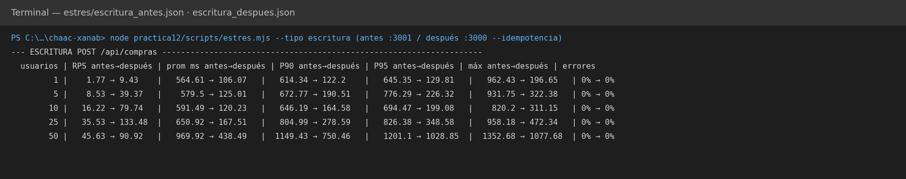

**Interpretación:** con la misma carga, la compra pasa de 565 a 106 ms con 1 usuario y el RPS máximo de 45.6 a 133.5. Ninguna de las 1,000 solicitudes falló. Con 50 usuarios aparece el nuevo punto de saturación, por el bloqueo de la fila del producto.

### C2. Historial y lectura
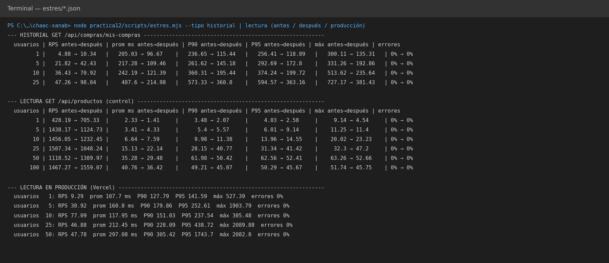

**Interpretación:** el historial paginado tarda la mitad y transfiere 98 % menos. La lectura del catálogo, que no se tocó, se mantiene en su meseta de unas 1,450 RPS (control). En producción, los arranques en frío de Vercel generan colas de unos 2 s.

### C3. Servidor e integridad
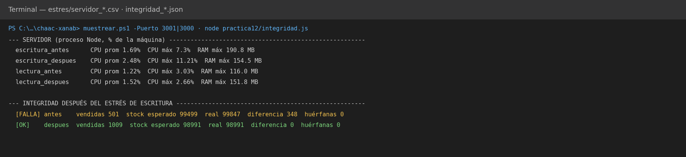

**Interpretación:** antes se perdieron 348 descuentos de stock en 501 compras; después, diferencia 0 y ninguna compra huérfana. El CPU del servidor nunca se acerca a saturarse: el límite no es Node.

### C4. Base de datos
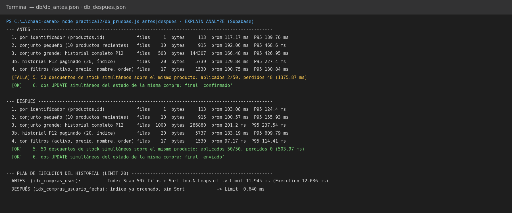

**Interpretación:** con 50 descuentos simultáneos se perdían 48 y ahora 0. El historial sin límite devolvió exactamente 1,000 filas: es el truncamiento de PostgREST (P12-D2).

### C5. Resiliencia
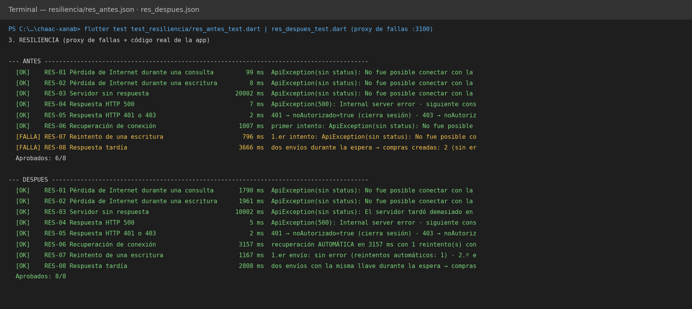

**Interpretación:** se pasa de 6/8 a 8/8. RES-07 y RES-08 dejan de duplicar compras gracias a la llave de idempotencia, y RES-06 se recupera sin intervención del usuario.

### C6. Profiling de la app
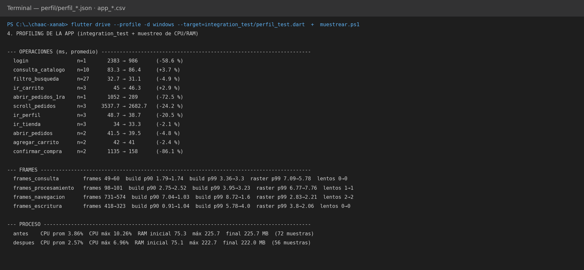

**Interpretación:** confirmar una compra baja 86 % y abrir Pedidos 73 %; el p99 de *build* en navegación pasa de 8.72 a 1.60 ms y el CPU promedio baja 33 %. La RAM casi no cambia.

### C7. Suites automatizadas
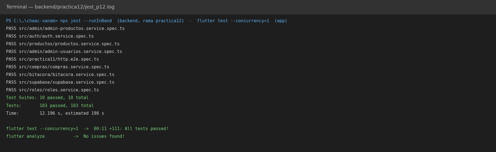

**Interpretación:** la optimización no rompió nada. Las pruebas que antes demostraban los defectos ahora exigen el comportamiento corregido.

### C8. Resumen
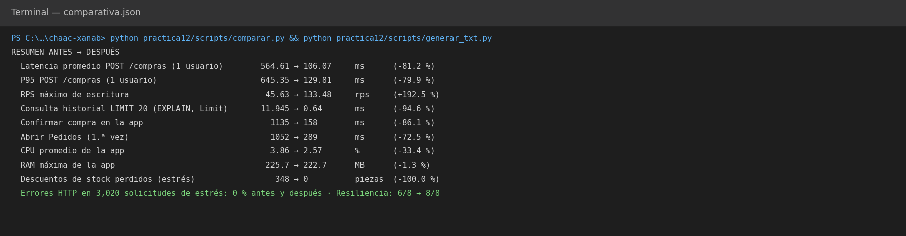

### S1–S8. Supabase SQL Editor

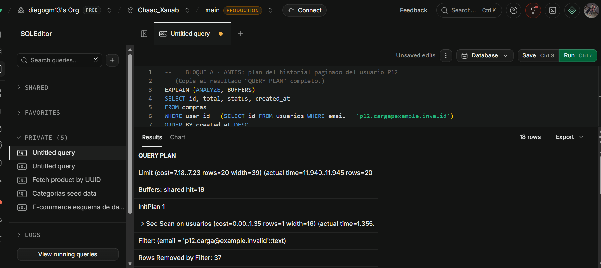

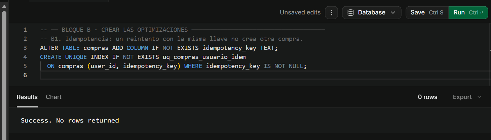

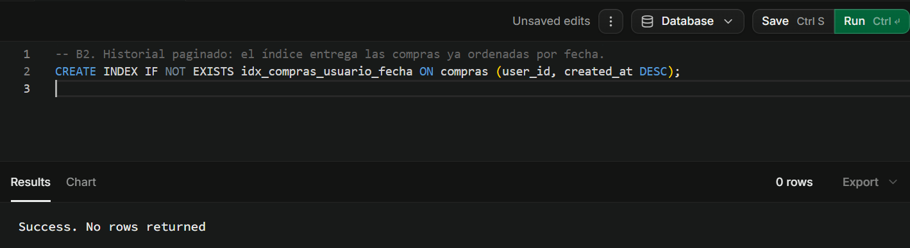

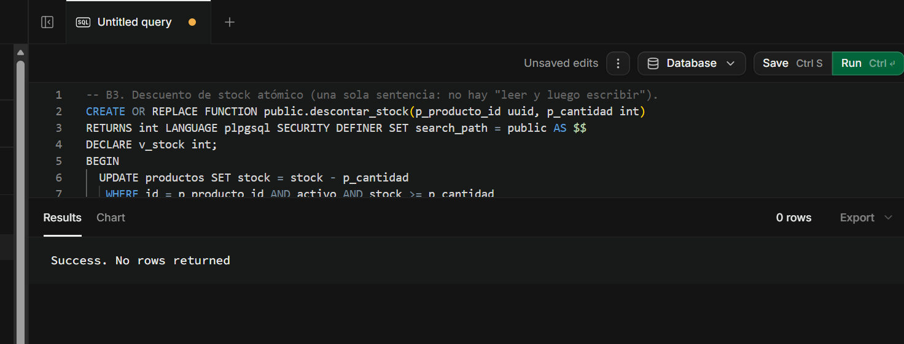

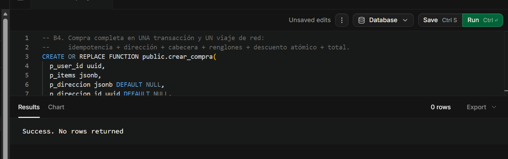

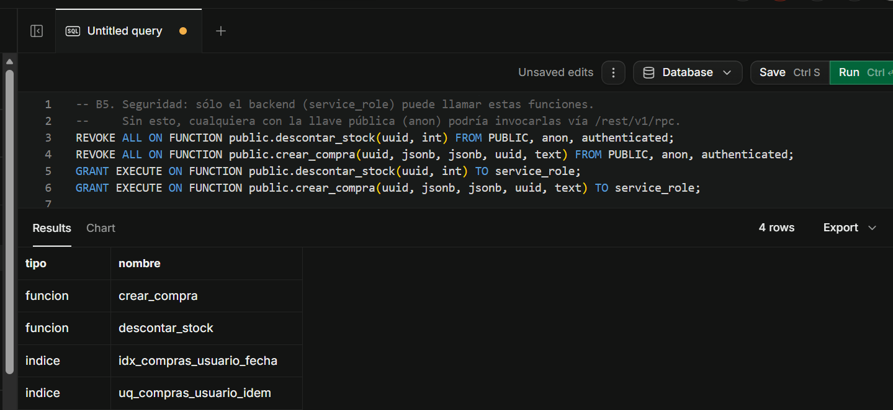

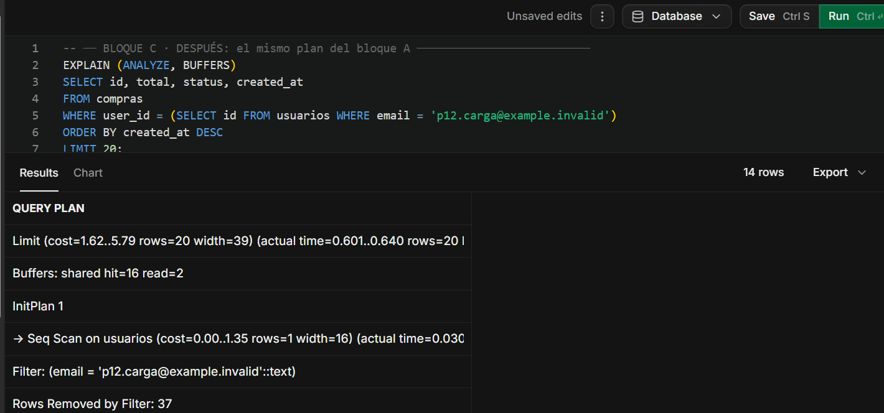

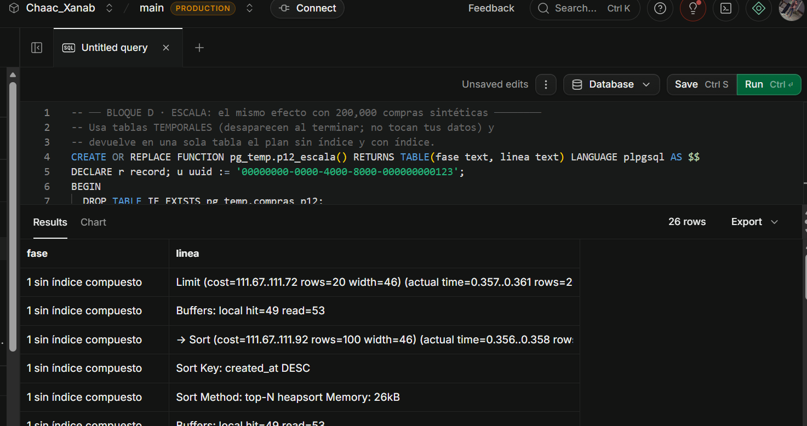

**Interpretación (S1/S7):** con el índice compuesto, PostgreSQL ya no lee y ordena todas las compras del usuario: toma las 20 primeras del índice. El nodo `Limit` baja de 11.945 a 0.640 ms.
