# Prácticas 13 y 14 — Automatización de pruebas y validación continua · CHAAC XANAB

**Repositorio de la app:** `https://github.com/diegogm13/aplicacion-chaac-xanab` (rama `practica13`, PR #1 hacia `main`) · **Backend:** `https://github.com/diegogm13/backend-chaac-xanab` (rama `practica13`; `master` y producción sin cambios) · **Fecha:** 18 de noviembre de 2026 · Flutter 3.44.0 · Node 22 · GitHub Actions `ubuntu-latest`.

## 1. Componentes críticos y riesgo a prevenir

| Componente | Elección | Por qué (prácticas 11-12) |
|---|---|---|
| Función crítica del móvil | **Compra**: carrito → checkout → `POST /compras` | Es donde aparecieron duplicados (DEF-01), sobreventa (DEF-03) y el ArgumentError con stock 0 (DEF-02) |
| Servicio / comunicación | **`ApiClient` + `TiendaService`**: JWT, traducción de errores, reintentos con backoff, `Idempotency-Key` | Un error aquí repercute en todas las pantallas |
| Persistencia | **SQLite local**: carrito (`CarritoService`) y registro (`UsuarioDao`) | El carrito debe sobrevivir al cierre de la app y no aceptar datos incompletos |

**Riesgo que se previene con una prueba automatizada:** DEF-02 seguía **abierto** desde la Práctica 11. Agregar un producto con stock 0 ejecutaba `cantidad.clamp(1, 0)` y lanzaba un `ArgumentError` no controlado. Se escribió primero la prueba (AUT-02), el CI la marcó en rojo y después se corrigió el código.

## 2. Pruebas automatizadas

| Archivo | Tipo | Pruebas | Qué validan |
|---|---|---|---|
| `test/p13/unitarias_test.dart` | Unitarias (AUT-01, 02, 03) | **9** | Entrada válida, vacía/nula y fuera de rango (límites 0/120, 4/5/6 dígitos, 7/8 caracteres); resultado esperado del carrito (total y piezas); excepción controlada con stock 0; formato y unicidad de la llave de idempotencia; 409 → `ApiException`; reintento de GET ante 503 y **ningún** reintento de un POST sin llave |
| `test/p13/integracion_http_test.dart` | Integración (AUT-04, 05) | **6** | **Servidor HTTP real** (`dart:io`) con el contrato de la API: la app envía cuerpo, token y llave correctos y recibe 201; un reintento con la misma llave devuelve la misma compra y descuenta el stock una sola vez; historial con `?limite=20`; 409, 401 y 503 → reintento → 200 |
| `test/p13/integracion_ui_test.dart` | Integración (AUT-05) | **1** | Con el servidor sin responder, `CheckoutScreen` muestra *“El servidor tardó demasiado en responder…”*, no muestra éxito, conserva el carrito y deja reintentar |
| `test/p13/persistencia_test.dart` | Persistencia (AUT-06) | **3** | El registro de usuario y el carrito se leen igual desde **otra conexión** a SQLite; un `INSERT` incompleto se rechaza sin dejar filas a medias |

**Adaptación justificada:** el backend real necesita las llaves de Supabase, y esas llaves no deben vivir en el CI. Por eso la integración de la app se prueba contra un servidor HTTP local que reproduce el contrato, con sockets reales y el código real de la app. Los endpoints **reales** del backend (guards, `ValidationPipe`, controladores) se prueban en su propio pipeline, con 103 pruebas que incluyen `http.e2e.spec.ts`.

## 3. Pipeline de integración continua

- **App** — `.github/workflows/ci.yml` se dispara en `push`, `pull_request` y a mano. Pasos: checkout → Flutter 3.44.0 (con caché) → `libsqlite3-dev` → `flutter pub get` → **`flutter analyze`** → **`flutter test test/p13`** → **suite completa con cobertura de líneas y ramas** → resumen en la página de la corrida → artefacto con los resultados JSON y `lcov.info`.
- **Backend** — `.github/workflows/ci.yml` se dispara en `push` y `pull_request`. Pasos: `npm ci` → **compilación de producción** (`tsc -p tsconfig.build.json`) → **Jest** con cobertura → resumen → artefacto. **No despliega:** Vercel publica producción sólo desde `master`, que no se modificó, así que la app y el sitio web siguen funcionando igual.

## 4. Resultados de la ejecución automática

| Corrida | Evento | Commit | Resultado | P13 (aprob./fall.) | Suite completa (aprob./fall.) | Duración |
|---|---|---|---|---|---|---|
| App #1 `44427255965` | push | `7e26b9a` pruebas + CI | ❌ **Falló** | 18 / **1** (11.0 s) | 129 / **1** (14.1 s) | 1 min 54 s |
| App #2 `44427905213` | push | `9712891` corrección DEF-02 | ✅ Éxito | 19 / 0 (8.9 s) | 130 / 0 (16.0 s) | 1 min 35 s |
| App #3 `44428152081` | push | `1d75dc5` proteger evidencia P11 | ✅ Éxito | 19 / 0 (11.9 s) | 130 / 0 (20.1 s) | 1 min 27 s |
| App #4 `44428162191` | **pull_request** | PR #1 | ✅ Éxito | 19 / 0 (11.3 s) | 130 / 0 (18.7 s) | 1 min 57 s |
| Backend `44427370291` | push | `9127fc5` CI backend | ✅ Éxito | — | **103 / 0**, 10 suites (7.6 s) | 32 s |

**Tiempo total de ejecución.** App: 6 min 53 s en 4 corridas (≈ 1.7 min por corrida). De eso, unos 26 s son instalar Flutter, 7 s el análisis estático y 11 + 17 s las pruebas. Backend: 32 s, de los cuales 8 s son pruebas. En local la suite completa de la app tarda unos 26 s (130/130).

### Errores encontrados y cambios para corregirlos

| # | Error | Detectado por | Corrección |
|---|---|---|---|
| E1 | **DEF-02:** `CarritoService.agregar()` con stock 0 → `ArgumentError` (`clamp(1, 0)`) | CI #1: la única prueba fallida de 130 | Si `stock <= 0`, lanza `CarritoException('… está agotado.')`; `cambiarCantidad` retira el renglón agotado; `ProductoScreen` muestra el mensaje; la prueba de la Práctica 11 que *demostraba* el defecto quedó como regresión. **CI #2 en verde** |
| E2 | Las pruebas `db_test` y `rendimiento_test` **reescribían en cada corrida** los JSON de evidencia de la Práctica 11, desalineándolos de su informe | Revisión del diff del commit de la corrección | Sólo escriben con `GUARDAR_METRICAS=1`; se restauraron los archivos originales. **CI #3 en verde** |
| A1 | Aviso de GitHub: `actions/checkout@v4` y `upload-artifact@v4` corren sobre Node.js 20, que está obsoleto | Anotación de la corrida | No rompe el flujo. Pendiente: subir a las versiones que usan Node 24 cuando se verifique su disponibilidad |

**Comprobación final (Fase 5):** después de la corrección se hicieron dos pushes más y se abrió un pull request. En las tres corridas el flujo se ejecutó solo y terminó en verde.

## 5. Matriz de automatización

| ID | Tipo | Prueba | Resultado | Evidencia |
|---|---|---|---|---|
| AUT-01 | Unitarias | Validaciones: válida, vacía/nula, fuera de rango (3 pruebas) | ✅ Aprobado (#1–#4) | `unitarias_test.dart` |
| AUT-02 | Unitarias | Carrito: resultado esperado, rangos, **excepción con stock 0** (3) | ❌ en #1 (DEF-02) → corregido → ✅ #2–#4 | `unitarias_test.dart`, `carrito_service.dart` |
| AUT-03 | Unitarias | Comunicación: llave, 409, reintentos (3) | ✅ Aprobado | `unitarias_test.dart` |
| AUT-04 | Integración | App → servicio HTTP real: 201, idempotencia, historial (3) | ✅ Aprobado | `integracion_http_test.dart` |
| AUT-05 | Integración | Códigos 409/401/503 y mensaje cuando el servidor no responde (4) | ✅ Aprobado | `integracion_http_test.dart`, `integracion_ui_test.dart` |
| AUT-06 | Persistencia | Registro y carrito persisten en SQLite; integridad (3) | ✅ Aprobado | `persistencia_test.dart` |
| AUT-07 | CI | El workflow corre solo en **push** y en **pull request** | ✅ 3 push + 1 PR ejecutados | Actions de `aplicacion-chaac-xanab`, PR #1 |
| AUT-08 | CI | Nuevo push tras la corrección re-ejecuta el flujo; CI del backend | ✅ #1 rojo → #2 verde; backend 103/103 | Corridas #2–#4, `backend-chaac-xanab` |

## 6. Conclusión técnica

La automatización convirtió la calidad de CHAAC XANAB en algo que **se comprueba en cada cambio** y no en algo que se recuerda revisar. El ejemplo más claro es DEF-02. Se había documentado en la Práctica 11, pero nada impedía que siguiera en el código. En cuanto existió una prueba que lo describía, el primer push quedó en rojo y GitHub señaló exactamente qué prueba fallaba, de 130. Tras la corrección, el siguiente push volvió a verde sin intervención manual. El defecto no puede regresar sin que el pipeline lo detecte.

El valor está en la **combinación de niveles**. Las pruebas unitarias fijan las reglas de negocio (límites de validación, cálculo del carrito, política de reintentos). Las de integración comprueban que esas reglas sobreviven al viaje por la red real (cuerpo, cabeceras, llave de idempotencia, códigos HTTP) y que la pantalla reacciona bien cuando el servidor no responde. Las de persistencia aseguran que los datos del usuario sobreviven a cerrar la app. Como la suite completa de las prácticas 11 a 14 corre en cada push (130 pruebas en unos 2 minutos, con análisis estático y cobertura), las optimizaciones de la Práctica 12 (transacción, idempotencia, paginación) quedan protegidas: si alguien las rompe, el CI lo marca antes del *merge*.

El proceso también reveló un error que nadie buscaba: las pruebas alteraban la evidencia de la Práctica 11 en cada ejecución. Lo detectó la revisión del *diff* que el flujo obliga a hacer. Que las pruebas no tengan efectos secundarios es parte de su confiabilidad.

Por último, el CI del backend permite modificar el servicio que comparten la app y el sitio web con una red de seguridad: corre la compilación de producción y las 103 pruebas sin credenciales y sin desplegar, de modo que **un cambio que rompa el backend se detecta en la rama**, antes de llegar a `master` y a los usuarios.

## 7. Corrección de todos los defectos abiertos (rama `correcciones`)

Después de las prácticas 11-14 se corrigieron **todos los defectos que seguían abiertos** en los tres proyectos, en ramas `correcciones` (sin tocar `master` ni producción). Cada corrección convirtió la prueba que *demostraba* el defecto en una **prueba de regresión**, y los tres CI corrieron en verde.

| Defecto | Proyecto | Corrección | Verificación |
|---|---|---|---|
| DEF-02 carrito con stock 0 | App | `CarritoException` controlada | CI app #2 (práctica 13) |
| DEF-04 SQLite sin `CHECK` | App | BD v4 con `CHECK` en `edad`/`nombre` y migración v3→v4 que conserva sólo filas válidas | 2 pruebas nuevas (inserción y migración) |
| DEF-10 respuesta inesperada → `TypeError` | App | `TiendaService` la convierte en `ApiException`; la tienda muestra “Reintentar” | prueba de servicio + prueba de pantalla |
| OBS-02 login acepta “a@” | App | Misma validación de correo que el registro | `flutter analyze` + suite |
| OBS-03 `actualizar()` sin id | App | Exige id y valida los datos | `db_test` |
| DEF-05 `/productos/abc` → 500 | API | `ParseUUIDPipe` en las 14 rutas con `:id` → **400** | e2e + verificado en vivo (400) |
| DEF-09 sin `helmet` en Vercel | API | `api/index.ts` aplica `helmet()` y quita `X-Powered-By` | verificado en vivo: `nosniff`, `X-Frame-Options`, HSTS, CSP |
| DEF-11 dependencias vulnerables | API | `npm audit fix` sin `--force`: 15 → 11, **0 críticas** | `tsc`, `nest build`, 103/103 |
| DEF-13 carrito web | Web | Compara por id, limita al stock, rechaza agotados, valida `localStorage` e índices | 4 pruebas de regresión |
| DEF-14 JWT mal decodificado | Web | base64url + UTF-8 | 2 pruebas de regresión |
| DEF-09 cabeceras del sitio | Web | `vercel.json`: `nosniff`, `X-Frame-Options`, `Referrer-Policy`, `Permissions-Policy` | `vercel.json` válido |
| P12-D2 historial sin paginar | Web | “Mis compras” de 20 en 20 con “Ver compras anteriores” | `ng build` |
| OBS-10 plantilla `App` | Web | Se eliminó; `main.server.ts` usaba esa plantilla y ahora arranca `AppComponent` | 41/41 (antes 42/43) |
| DEF-11 dependencias web | Web | `npm audit fix`: 13 → 8, **0 críticas** | `ng test` + `ng build` |
| A1 aviso Node 20 en CI | Los 3 | Acciones `@v7` | las corridas ya no muestran el aviso |

| CI de la rama `correcciones` | Resultado |
|---|---|
| App `44435435304` | ✅ 132/132, `flutter analyze` sin problemas |
| Backend `44435439858` | ✅ 103/103, compilación de producción OK |
| Sitio web `44435453362` (CI nuevo) | ✅ 41/41, `ng build` OK |

**Pendientes por decisión, no por omisión:** las 11 vulnerabilidades restantes del backend y las 8 del sitio exigen saltos de versión mayor (NestJS 11, multer 2, nodemailer ≥ 7, Angular), que podrían romper el backend que comparten la app y la web. P12-D6 (bloqueo de fila con 50 compras simultáneas del mismo producto) es el costo correcto de la consistencia. DEF-07 (borrar un usuario borra sus compras) fue una decisión de diseño documentada en `migration-borrado-usuario.sql`. Nada de esto llega a producción hasta que se fusionen las ramas y Vercel despliegue.

## 8. La aplicación en ejecución

Capturas de la app **real** compilada en modo *profile* en Windows, con tamaño de teléfono (412 × 860), conectada al backend corregido y a la base de Supabase. Las tomó `integration_test/capturas_test.dart`, que maneja la app como un usuario. Los productos “P12” son datos temporales de prueba, borrados al terminar.

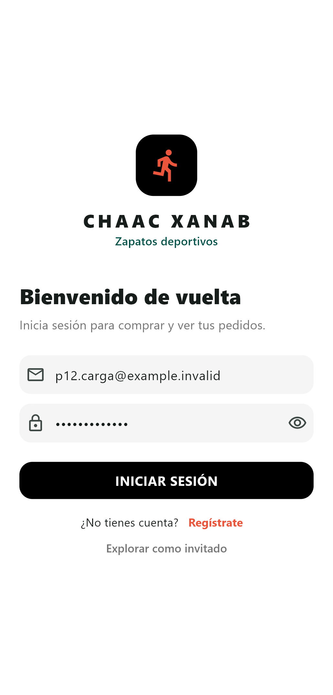

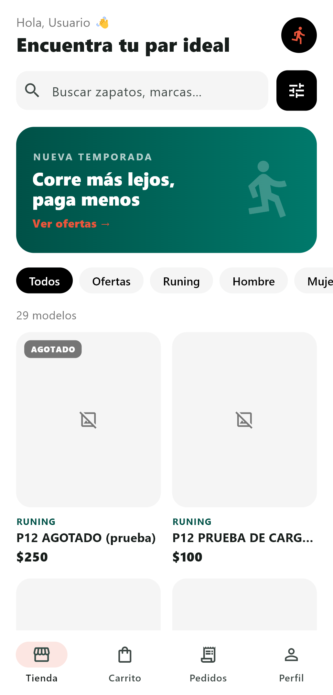

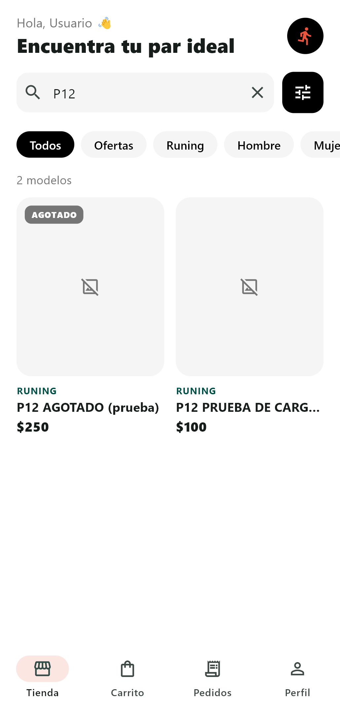

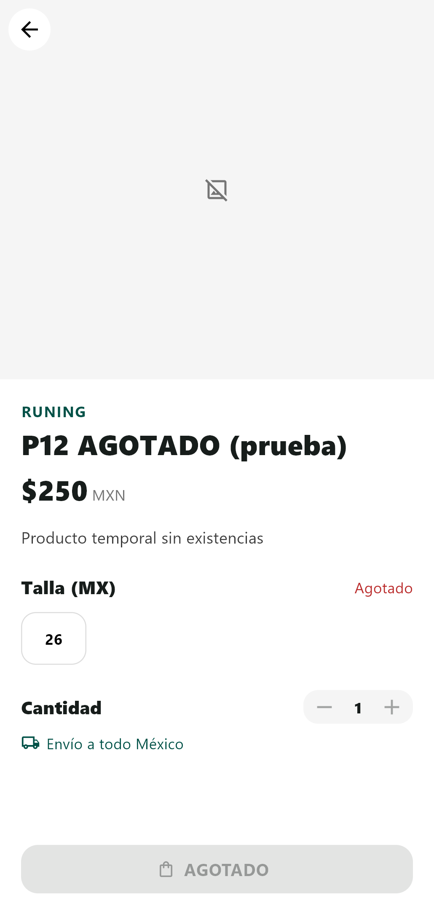

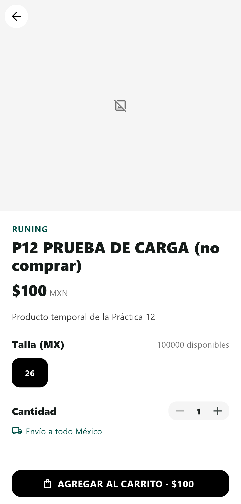

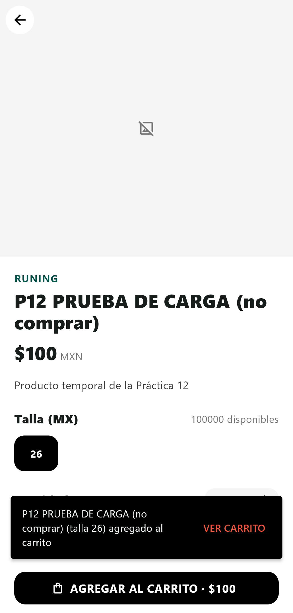

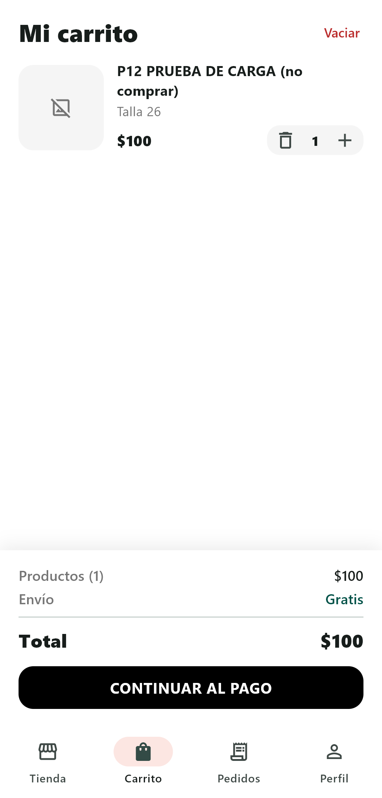

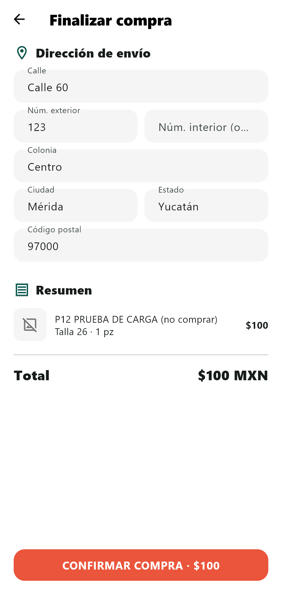

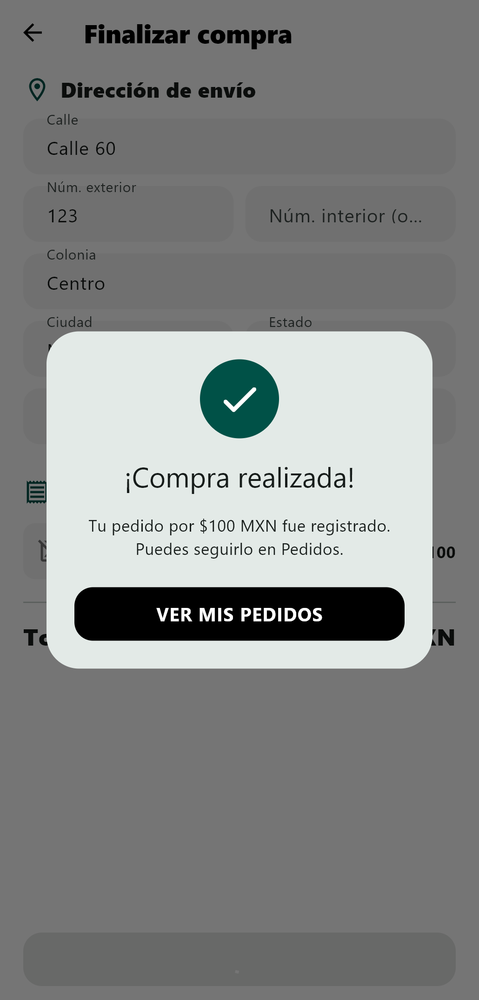

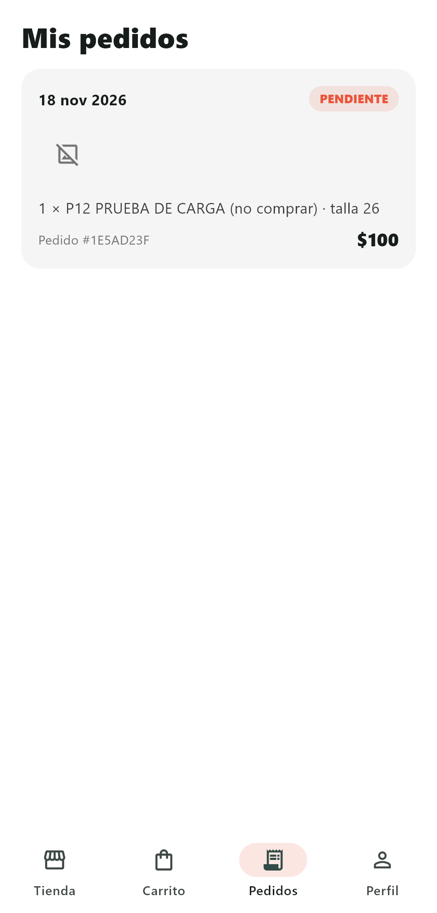

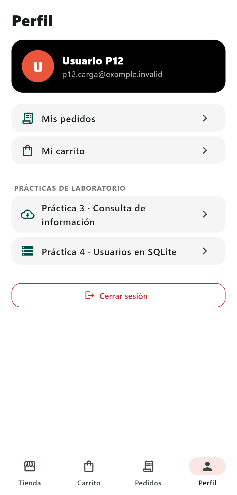

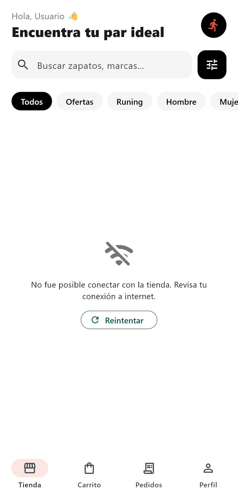

---

## Anexo — Evidencia de la ejecución automática

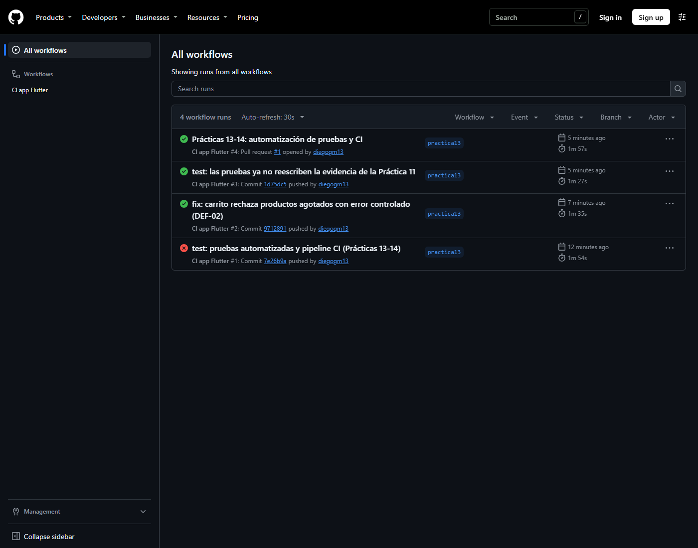

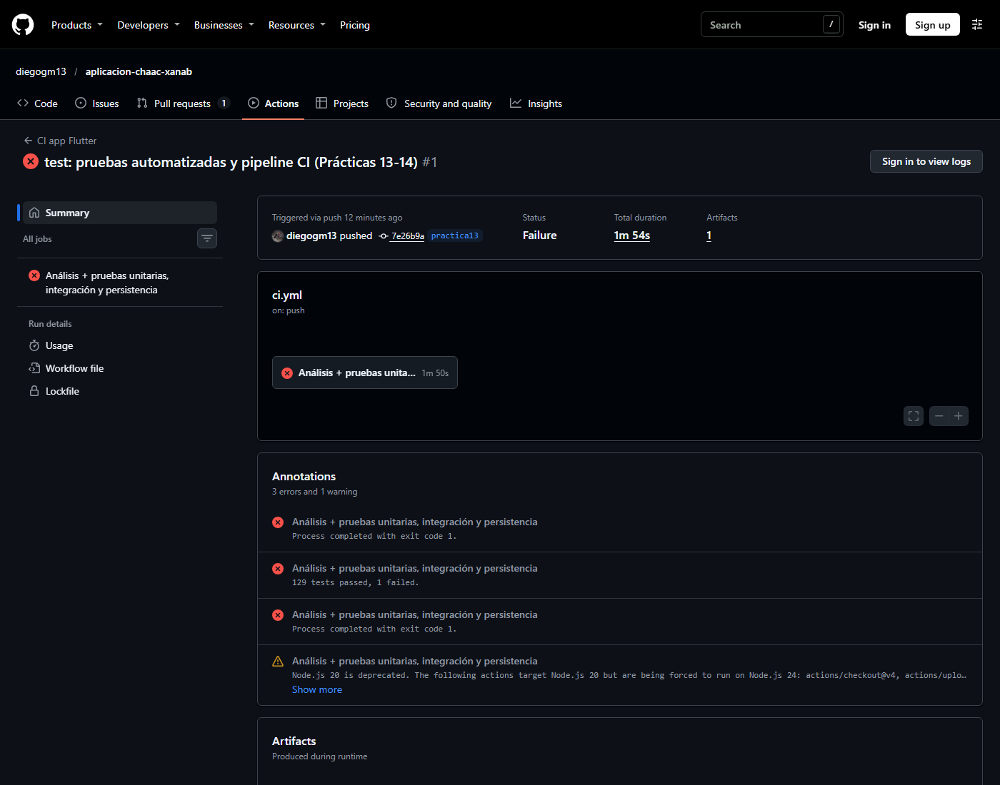

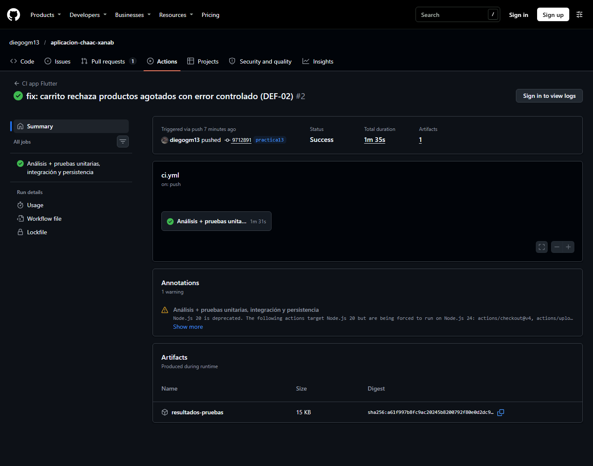

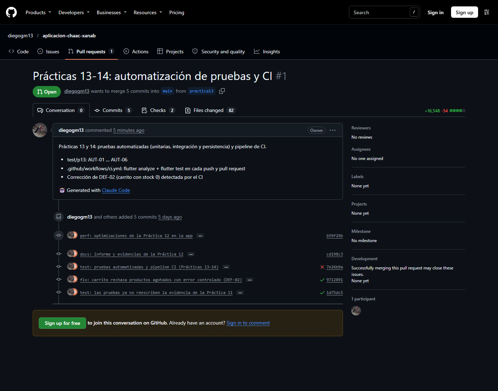

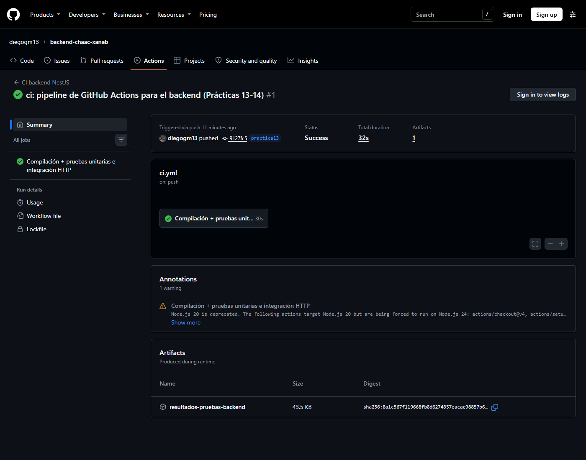

Detalle por corrida (pasos, duraciones y pruebas fallidas): `practica13/resultados/ci.json`, generado con `practica13/scripts/evidencia_ci.py`.
